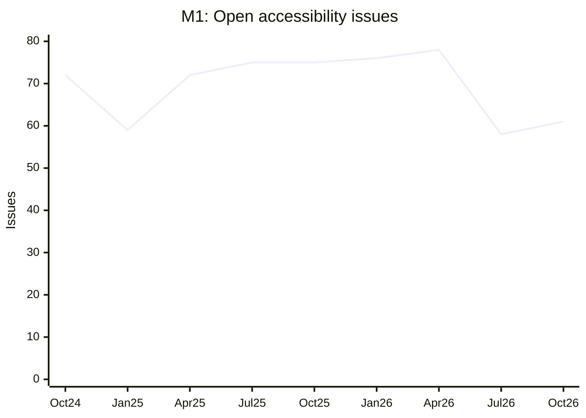
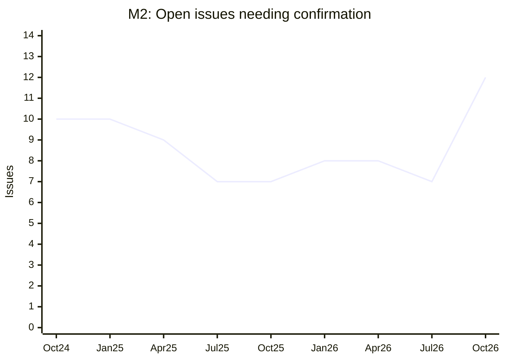
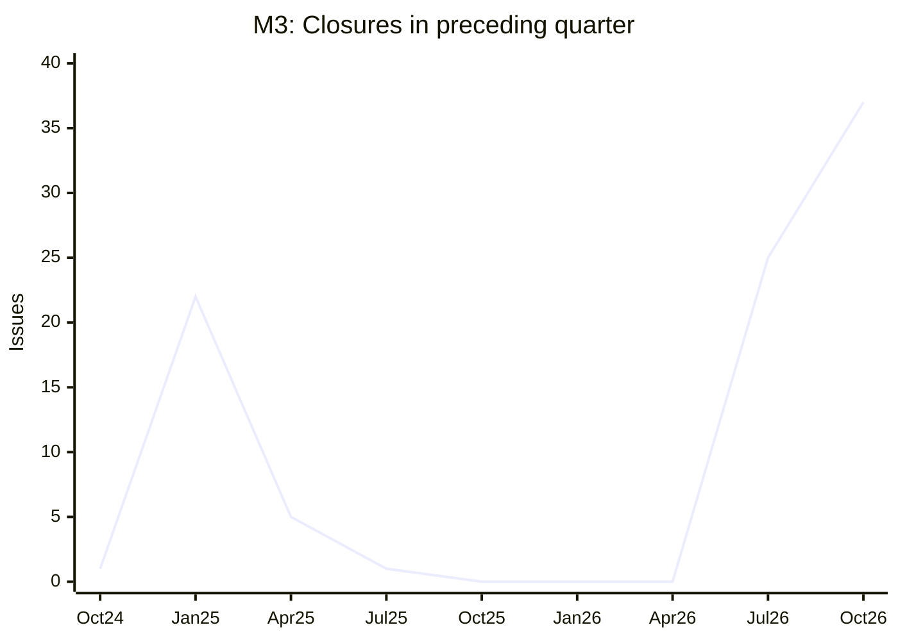
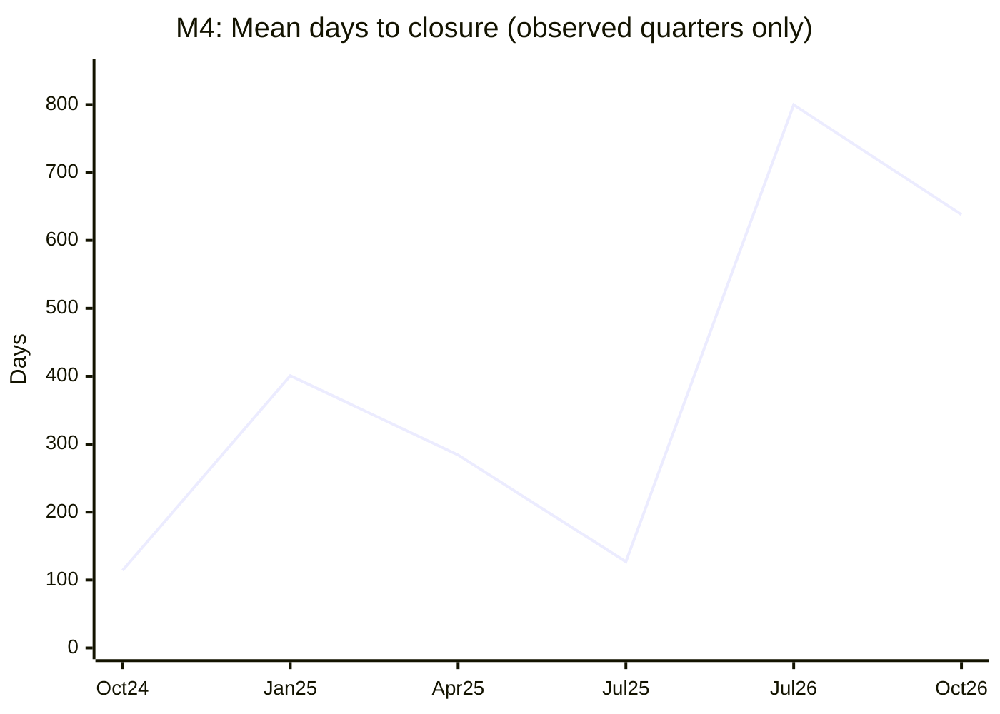
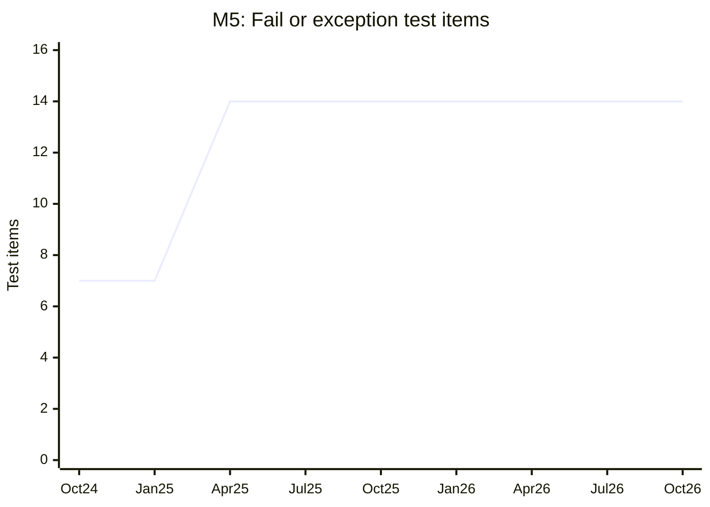
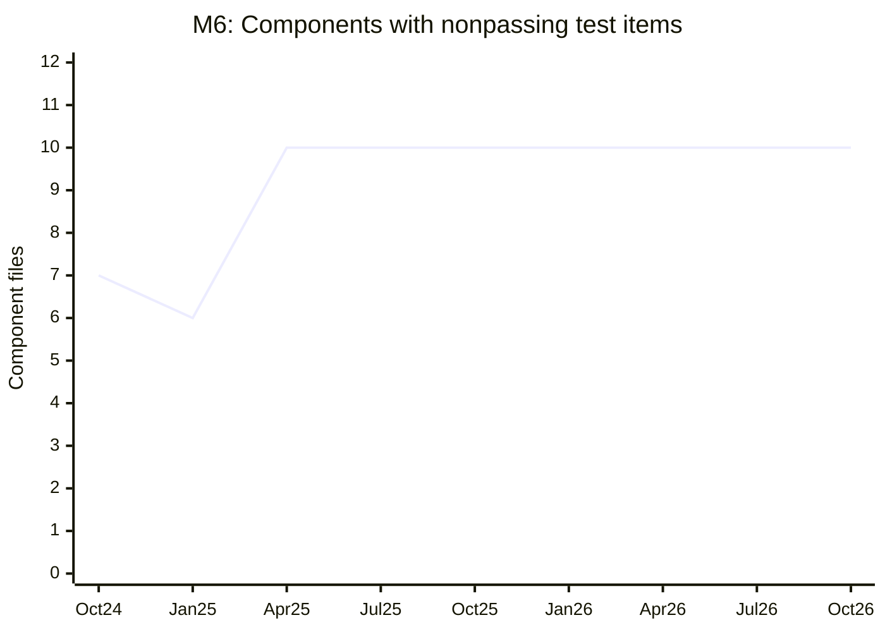
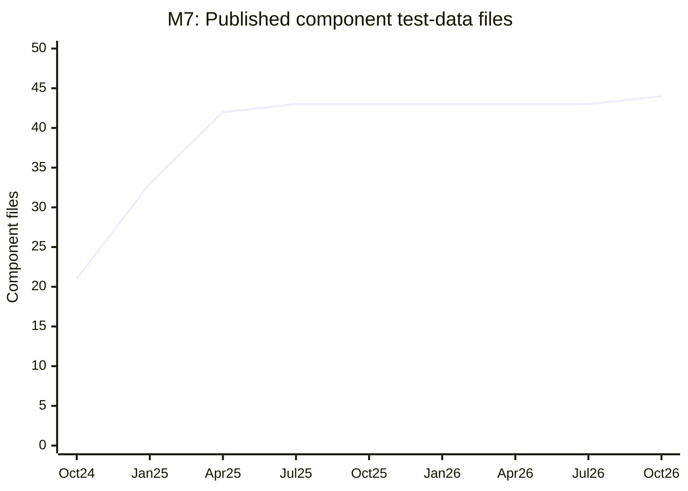
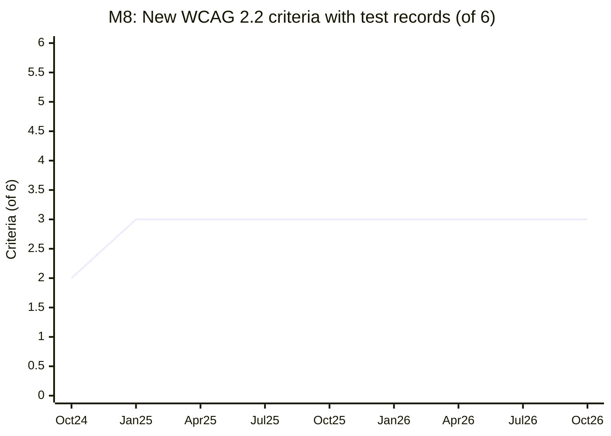

# USWDS Accessibility Measurement Program — v2

**Measurement standard:** WCAG 2.2 AA

**Baseline:** October 1, 2026, at 00:00 UTC

**Historical snapshots:** Every three months from October 1, 2024, through October 1, 2026

**Status:** Draft for review

## Executive summary

USWDS publishes something unusually useful for an accessibility measurement program: [individual component test results](https://github.com/uswds/uswds-site/tree/main/_data/accessibility-tests) with outcomes that include `pass`, `conditional`, `exception`, and `fail`. Its [issue tracker](https://github.com/uswds/uswds/issues) supplies a second, different view: reported work that has not necessarily been incorporated into those test results.

At the October 1, 2026 baseline, **61 accessibility-labeled issues were open**, **12 of them also needed confirmation**, and **14 documented component test items had a `fail` or `exception` result**. The 14 results occurred in **10 component files**. These figures are not interchangeable: an issue can cover multiple tests, and a test result can remain published after its linked issue closes.

This revision replaces v1’s criterion-by-criterion counts as the *primary program metrics*. It retains those counts as diagnostic detail, but measures the backlog, its disposition, the published test inventory, and WCAG 2.2 coverage over time. Peer repositories support the **practices** behind the targets; where they do not publish comparable numerical outcomes, the numerical target is explicitly based on USWDS history rather than attributed to a peer.

> **Important scope distinction:** These are measures of published component tests and labeled repository issues—not a WCAG conformance claim for every USWDS implementation, nor a measure of accessibility across websites using USWDS.

## Peer benchmark

The table distinguishes **public evidence of a practice** from **public outcome data**. “Not verified” means the cited sources checked did not establish the practice or a comparable result; it does **not** mean the team never performs it.

| Peer and source checked | Automated testing evidenced | Manual testing evidenced | What is publicly reported—and limitation for target-setting |
|---|---|---|---|
| **GOV.UK Design System.** [Design System repository](https://github.com/alphagov/govuk-design-system); [Frontend component test suites](https://github.com/alphagov/govuk-frontend/tree/main/packages/govuk-frontend/src/govuk/components); [accessibility acceptance criteria](https://github.com/alphagov/govuk-frontend/blob/main/docs/contributing/test-components-using-accessibility-acceptance-criteria.md). | Component-specific Puppeteer/axe suites; **39** files named `accessibility.puppeteer.test.mjs` were present when checked. [Accordion example](https://github.com/alphagov/govuk-frontend/blob/main/packages/govuk-frontend/src/govuk/components/accordion/accessibility.puppeteer.test.mjs) runs examples against an axe no-violations assertion. | Published acceptance criteria call for realistic-page and assistive-technology testing and testing with disabled people. | Publishes criteria and methodology. The sources checked did **not** establish a public quarterly count of component failures or time-to-close comparable to the USWDS metrics below. |
| **IBM Carbon.** [Carbon repository](https://github.com/carbon-design-system/carbon); [accessibility testing guide](https://github.com/carbon-design-system/carbon/blob/main/docs/guides/accessibility.md). | Documents automated verification testing with IBM’s Dynamic Assessment Plugin and recording scan reports. | Documents keyboard and screen-magnifier checks; describes a separate screen-reader verification stage. | Publishes a staged method and instructions for recording findings, not a public, reproducible quarterly system-wide outcome series in the guide checked. |
| **GitHub Primer.** [Primer website source](https://github.com/primer/primer.style); [React implementation](https://github.com/primer/react); [axe end-to-end suite](https://github.com/primer/react/blob/main/e2e/components/Axe.test.ts). | Playwright suite iterates Storybook stories across themes and asserts no axe violations; the file also records **explicit skipped stories**, including some with known violations. | The sources checked—the website repository and cited React test suite—do not, by themselves, establish a system-wide manual-test protocol. **Not verified from those sources.** | Publishes test code and exclusions, rather than a comparable quarterly backlog or failure-time series. The explicit exclusions are a useful transparency practice; a passing automated run alone is not complete coverage. |
| **Salesforce Lightning.** [SLDS source repository](https://github.com/salesforce-ux/design-system); [axe task](https://github.com/salesforce-ux/design-system/blob/master/scripts/gulp/accessibility/axe.js); [SLDS 2 issue repository](https://github.com/salesforce-ux/design-system-2). | Archived source contains a `gulp-axe-webdriver` task and [accessibility workflow](https://github.com/salesforce-ux/design-system/blob/master/.github/workflows/a11y.yml). Its axe task explicitly sets `errorOnViolation: false`; do not equate its presence with a blocking gate. | **Not verified** from the archived source’s README, axe task, and SLDS 2 issue-repository README checked. | The original source repository is **archived**; the SLDS 2 repository says it tracks package issues. These do not supply a defensible current, comparable quarterly outcome series. |
| **Adobe Spectrum.** [React Spectrum](https://github.com/adobe/react-spectrum); [docs accessibility scan script](https://github.com/adobe/react-spectrum/blob/main/packages/dev/s2-docs/scripts/testAccessibility.mjs); [contributing guide](https://github.com/adobe/react-spectrum/blob/main/CONTRIBUTING.md). | Playwright/axe documentation-page scanner, with named known false-positive exclusions. | Contributing guidance explicitly considers mouse, touch, keyboard, and screen-reader interaction; a quantified manual audit schedule was **not verified** from these sources. | Publishes testing code and documented exclusions. The sources checked did not yield comparable quarterly component-outcome totals. Its exclusion documentation supports publishing USWDS exceptions separately, rather than hiding them. |
| **Shopify Polaris.** [Archived React repository](https://github.com/Shopify/polaris-react-archive); [accessibility testing guide](https://github.com/Shopify/polaris-react-archive/blob/main/documentation/Accessibility%20testing.md); [Storybook test runner](https://github.com/Shopify/polaris-react-archive/blob/main/polaris-react/.storybook/test-runner.ts). | Archived React implementation uses axe in its Storybook runner; the guide recommends local Pa11y testing. | Guide provides a change-sensitive manual checklist covering structure, visual presentation, keyboard, dynamic content, mobile, and media. | Publishes process and test code. **This implementation is archived**, and Shopify directs current app developers to Polaris Web Components; its historical repository is evidence of a practice, **not** a current peer performance baseline. A comparable current outcome series was not verified from the cited sources. |
| **Visa Product Design System.** [Nova React](https://github.com/visa/nova-react); [Nova styles](https://github.com/visa/nova-styles). | Nova React’s README describes Jest, axe, and snapshot testing. | A defined manual test schedule was **not verified** from the Nova React and Nova styles READMEs checked. | Publishes component source and testing approach; no comparable quarterly outcome series was verified from those sources. |
| **Nordhealth Nord.** [Public organization repositories](https://github.com/orgs/nordhealth/repositories); [React example](https://github.com/nordhealth/react-example-project). | **Not verified.** The public repository checked is a *consumer example*, not verified primary Nord component source. | **Not verified** from that example and the organization’s public repository listing. | The checked sources do not substantiate a public component-result series. Do not infer one from the example project. |
| **NYC Design System.** [Source repository](https://github.com/nycdigitalservice/nyc-design-system). | **Not verified** from its README and repository tree checked. | **Not verified** from the same sources. | README publishes implementation and contribution information, but no comparable results were verified. Its last recorded push when checked was April 2024, limiting its usefulness as a current performance comparator. |
| **NSW Design System.** [Source repository](https://github.com/NSWGTP/nsw-design-system); [axe/Playwright scanner](https://github.com/NSWGTP/nsw-design-system/blob/master/a11y-test.js); [CI workflow](https://github.com/NSWGTP/nsw-design-system/blob/master/.github/workflows/a11y-test-critical.yml). | PR/push workflow runs an axe/Playwright scan and publishes a step summary. **Its configured failure threshold is `critical`**, not all violation severities. | **Not verified** from its README, scanner, `.pa11yci`, and cited workflow checked. | Publishes its scan implementation and a per-run CI summary, not a verified historical quarterly component-outcome series. The visible severity threshold is a reminder to state what an automated gate does *not* catch. |

**Benchmark conclusion.** GOV.UK, Carbon, Primer, Adobe, and historical Polaris provide strong evidence for combining automated checks with explicit manual criteria and documented exclusions. Their cited public materials do **not** provide a like-for-like numerical target for USWDS’s issue backlog, closure time, or `exception` count. Those targets below therefore use **USWDS’s observed values**. This is narrower and more defensible than claiming that a peer’s accessibility commitment implies a particular numerical threshold.

## Definitions, baseline, and proposed FY2027 targets

The scorecard uses eight **distinct** metrics. “Higher” or “lower” describes the proposed direction, not proof that any single change caused accessibility to improve.

| ID | Metric and working definition | Data source | Oct. 1, 2026 baseline | Proposed FY27 target and justification |
|---|---|---|---:|---|
| **M1** | **Open accessibility-labeled issues:** distinct open `uswds/uswds` issues carrying `Affects: Accessibility 🟡` at the snapshot. | [`uswds/uswds` issues](https://github.com/uswds/uswds/issues) and [issue-event history](https://docs.github.com/en/rest/issues/events#list-issue-events-for-a-repository). | **61** | **≤50** at FY27 year-end. USWDS was at 58 on July 1, 2026, so 50 is an improvement beyond an observed low, not a purported peer median. Peer support: Carbon’s documented practice of filing scan violations and GOV.UK’s acceptance criteria make a visible, actionable backlog important. |
| **M2** | **Open accessibility issues needing confirmation:** subset of M1 also carrying `Needs: Confirmation` at the snapshot. This measures an unresolved validation queue, **not severity**. | [`uswds/uswds` issues](https://github.com/uswds/uswds/issues) and [issue-event history](https://docs.github.com/en/rest/issues/events#list-issue-events-for-a-repository) for both labels. | **12** | **≤6** at FY27 year-end. USWDS previously reached 7 (July and October 2025; July 2026). Six requires improvement on that observed level. GOV.UK’s explicit acceptance criteria and Carbon’s reproducibility requirements support prompt validation, but neither supplies the number six. |
| **M3** | **Accessibility issues closed in the preceding calendar quarter:** distinct issues carrying the accessibility label **when closed**; count once per quarter even after multiple closures in that quarter. A reopened issue can count in two different quarters. | [`uswds/uswds` issues](https://github.com/uswds/uswds/issues) and [closure/label events](https://docs.github.com/en/rest/issues/events#list-issue-events-for-a-repository). | **37** in Q3 2026 | **≥20 per quarter** as an FY27 operating target, reported alongside M1 and new-issue inflow. Twenty is within demonstrated USWDS capacity (22 in Q4 2024; 25 in Q2 2026; 37 in Q3 2026), not a peer-derived closure quota. Once the backlog falls, a lower closure count may be healthy; never optimize this metric alone. |
| **M4** | **Mean elapsed days to closure for M3:** arithmetic mean of *last closure in that quarter minus original creation*, one duration per issue. Closed intervals after prior closures are **not** subtracted. Report `N/A` if M3 is zero. | [Issue creation timestamps](https://github.com/uswds/uswds/issues) and [closure/label events](https://docs.github.com/en/rest/issues/events#list-issue-events-for-a-repository). | **638.0 days** in Q3 2026 | **≤365 days** for FY27 quarters with closures. USWDS achieved 400.8 in Q4 2024 and 284.2 in Q1 2025; 365 aims to return below the former. Historical backlog cleanups can initially raise the mean. Compare with M1, M3, and the median before drawing conclusions. No cited peer provides comparable time-to-close data. |
| **M5** | **Published nonpassing test items:** `test_items` in all snapshot YAML files with `test_status` exactly `fail` **or** `exception`. | [Baseline accessibility-test YAML tree](https://github.com/uswds/uswds-site/tree/4393275e292b2c081cc543198d895441aa4218d4/_data/accessibility-tests); [historical commits below](#how-to-reproduce-the-numbers). | **14** (1 fail; 13 exceptions) | **≤10**, with **0 `fail`**, by FY27 year-end. Ten improves on the plateau of 14 recorded since April 2025; seven was observed in late 2024/early 2025 when the published inventory was smaller. Adobe’s named axe exclusions and Primer’s explicit skipped tests support retaining visible exception counts, *not* silently reclassifying them. |
| **M6** | **Components with a published nonpassing test item:** number of distinct component YAML files containing at least one M5 item. Multiple items in one file count once. | [Baseline component-test YAML files](https://github.com/uswds/uswds-site/tree/4393275e292b2c081cc543198d895441aa4218d4/_data/accessibility-tests); [historical commits below](#how-to-reproduce-the-numbers). | **10 of 44 files** | **≤7 affected components** by FY27 year-end. Seven was observed in October 2024, when only 21 files existed; thus this is an improvement target **conditional on maintaining or increasing inventory** (M7), not a claim of comparable historical coverage. GOV.UK’s component-specific suites and Carbon’s per-component audit records support measuring impact by component. |
| **M7** | **Published component-test inventory:** number of component `.yml` files under the accessibility-test data directory at the snapshot. This measures **documented scope**, not pass rate. | [Baseline accessibility-test directory](https://github.com/uswds/uswds-site/tree/4393275e292b2c081cc543198d895441aa4218d4/_data/accessibility-tests); [historical commits below](#how-to-reproduce-the-numbers). | **44 files**, containing **503 test items** | **≥48 files** by FY27 year-end, without reducing published test-item coverage. USWDS grew from 21 files in October 2024 to 44; four additional files are a proposed, achievable increment, subject to identifying relevant components. GOV.UK’s component-specific test suites motivate explicit inventory coverage; its suite count is **not** directly comparable to USWDS file count. |
| **M8** | **New WCAG 2.2 A/AA criteria with at least one explicit test record:** distinct criteria among the six listed below appearing in a `wcag_criterion` field. This is **documented test presence**, not automated coverage or conformance. | [`wcag_criterion` fields in baseline YAML](https://github.com/uswds/uswds-site/tree/4393275e292b2c081cc543198d895441aa4218d4/_data/accessibility-tests) compared with [WCAG 2.2](https://www.w3.org/TR/WCAG22/); [historical commits below](#how-to-reproduce-the-numbers). | **3 of 6** | **6 of 6** by FY27 year-end, with a recorded outcome and method for each. USWDS has already documented tests for three; GOV.UK’s [WCAG-related acceptance criteria](https://github.com/alphagov/govuk-frontend/blob/main/docs/contributing/test-components-using-accessibility-acceptance-criteria.md) support closing explicit criteria gaps. Neither the peer nor this metric establishes conformance. |

### WCAG 2.2 accounting and exclusions

The six A/AA success criteria added in WCAG 2.2 are **2.4.11 Focus Not Obscured (Minimum), 2.5.7 Dragging Movements, 2.5.8 Target Size (Minimum), 3.2.6 Consistent Help, 3.3.7 Redundant Entry, and 3.3.8 Accessible Authentication (Minimum)**. At baseline, published USWDS test records explicitly reference **2.4.11, 2.5.7, and 2.5.8**; none of the other three was found in the records counted for M8. **4.1.1 Parsing was removed in WCAG 2.2** and is not counted as a current criterion. [WCAG 2.2](https://www.w3.org/TR/WCAG22/) is the normative reference.

M8 must not be described as the “share of WCAG criteria covered by **automated** tests”: its source is published component *test results*, which include manual testing. Likewise, an unreferenced criterion is **not automatically an applicable failure** for every component.

The YAML [data-key guide](https://github.com/uswds/uswds-site/blob/main/_data/accessibility-tests/_README.md) defines `conditional` separately from `fail` and `exception`. **Conditional results are excluded from M5 and M6**, not treated as passes or silently discarded. There were **110 conditional items** among 503 items at baseline. They should appear as a separate contextual count and be investigated for dependency on consumer implementation or context; treating them as definite component failures would change the question being measured.

V1’s criterion table contained **3.3.3, 3.3.2, 1.4.10, 2.1.1, 2.4.6, 1.3.5, 3.2.2, and 2.4.7**. It omitted **1.3.1 Info and Relationships** and **2.4.3 Focus Order**, both represented by baseline `exception` records (respectively in `file-input.yml` and `header.yml`). Thus its criterion subtotals could not account for all 14 baseline `fail`/`exception` test items. These two criteria are included in M5 and M6; all ten criteria can be retained in a diagnostic appendix. A test item is not necessarily a unique defect or a unique WCAG failure.

### V1 component/criterion results (diagnostic detail)

The following is a linked table, with all **14** baseline `fail` or `exception` items in the [October 1, 2026 snapshot](https://github.com/uswds/uswds-site/tree/4393275e292b2c081cc543198d895441aa4218d4/_data/accessibility-tests). It is **not** eight additional program metrics. Each row represents one test item; repeated criteria or components are intentional. Links to component pages are for reading the published results; the pinned YAML links are the historical source of the status.

| WCAG 2.2 criterion | Component | Result | Historical data |
|---|---|---|---|
| [1.3.1 Info and Relationships](https://www.w3.org/TR/WCAG22/#info-and-relationships) | [File input](https://designsystem.digital.gov/components/file-input/accessibility-tests/) | Exception | [`file-input.yml`](https://github.com/uswds/uswds-site/blob/4393275e292b2c081cc543198d895441aa4218d4/_data/accessibility-tests/file-input.yml) |
| [1.3.5 Identify Input Purpose](https://www.w3.org/TR/WCAG22/#identify-input-purpose) | [Input mask](https://designsystem.digital.gov/components/input-mask/accessibility-tests/) | Exception | [`input-mask.yml`](https://github.com/uswds/uswds-site/blob/4393275e292b2c081cc543198d895441aa4218d4/_data/accessibility-tests/input-mask.yml) |
| [1.4.10 Reflow](https://www.w3.org/TR/WCAG22/#reflow) | [Button](https://designsystem.digital.gov/components/button/accessibility-tests/) | Exception | [`button.yml`](https://github.com/uswds/uswds-site/blob/4393275e292b2c081cc543198d895441aa4218d4/_data/accessibility-tests/button.yml) |
| [2.1.1 Keyboard](https://www.w3.org/TR/WCAG22/#keyboard) | [Table](https://designsystem.digital.gov/components/table/accessibility-tests/) | Exception | [`table.yml`](https://github.com/uswds/uswds-site/blob/4393275e292b2c081cc543198d895441aa4218d4/_data/accessibility-tests/table.yml) |
| [2.1.1 Keyboard](https://www.w3.org/TR/WCAG22/#keyboard) | [Search](https://designsystem.digital.gov/components/search/accessibility-tests/) | Exception | [`search.yml`](https://github.com/uswds/uswds-site/blob/4393275e292b2c081cc543198d895441aa4218d4/_data/accessibility-tests/search.yml) |
| [2.4.3 Focus Order](https://www.w3.org/TR/WCAG22/#focus-order) | [Header](https://designsystem.digital.gov/components/header/accessibility-tests/) | Exception | [`header.yml`](https://github.com/uswds/uswds-site/blob/4393275e292b2c081cc543198d895441aa4218d4/_data/accessibility-tests/header.yml) |
| [2.4.6 Headings and Labels](https://www.w3.org/TR/WCAG22/#headings-and-labels) | [Language selector](https://designsystem.digital.gov/components/language-selector/accessibility-tests/) | Exception | [`language-selector.yml`](https://github.com/uswds/uswds-site/blob/4393275e292b2c081cc543198d895441aa4218d4/_data/accessibility-tests/language-selector.yml) |
| [2.4.7 Focus Visible](https://www.w3.org/TR/WCAG22/#focus-visible) | [File input](https://designsystem.digital.gov/components/file-input/accessibility-tests/) | Exception | [`file-input.yml`](https://github.com/uswds/uswds-site/blob/4393275e292b2c081cc543198d895441aa4218d4/_data/accessibility-tests/file-input.yml) |
| [3.2.2 On Input](https://www.w3.org/TR/WCAG22/#on-input) | [Language selector](https://designsystem.digital.gov/components/language-selector/accessibility-tests/) | Exception | [`language-selector.yml`](https://github.com/uswds/uswds-site/blob/4393275e292b2c081cc543198d895441aa4218d4/_data/accessibility-tests/language-selector.yml) |
| [3.3.2 Labels or Instructions](https://www.w3.org/TR/WCAG22/#labels-or-instructions) | [Input mask](https://designsystem.digital.gov/components/input-mask/accessibility-tests/) | Exception | [`input-mask.yml`](https://github.com/uswds/uswds-site/blob/4393275e292b2c081cc543198d895441aa4218d4/_data/accessibility-tests/input-mask.yml) |
| [3.3.2 Labels or Instructions](https://www.w3.org/TR/WCAG22/#labels-or-instructions) | [Date picker](https://designsystem.digital.gov/components/date-picker/accessibility-tests/) | Exception | [`date-picker.yml`](https://github.com/uswds/uswds-site/blob/4393275e292b2c081cc543198d895441aa4218d4/_data/accessibility-tests/date-picker.yml) |
| [3.3.2 Labels or Instructions](https://www.w3.org/TR/WCAG22/#labels-or-instructions) | [Date range picker](https://designsystem.digital.gov/components/date-range-picker/accessibility-tests/) | Exception | [`date-range-picker.yml`](https://github.com/uswds/uswds-site/blob/4393275e292b2c081cc543198d895441aa4218d4/_data/accessibility-tests/date-range-picker.yml) |
| [3.3.3 Error Suggestion](https://www.w3.org/TR/WCAG22/#error-suggestion) | [Input mask](https://designsystem.digital.gov/components/input-mask/accessibility-tests/) | Fail | [`input-mask.yml`](https://github.com/uswds/uswds-site/blob/4393275e292b2c081cc543198d895441aa4218d4/_data/accessibility-tests/input-mask.yml) |
| [3.3.3 Error Suggestion](https://www.w3.org/TR/WCAG22/#error-suggestion) | [Character count](https://designsystem.digital.gov/components/character-count/accessibility-tests/) | Exception | [`character-count.yml`](https://github.com/uswds/uswds-site/blob/4393275e292b2c081cc543198d895441aa4218d4/_data/accessibility-tests/character-count.yml) |

## One-page quarterly scorecard

**Reading the table:** The first eight columns are **historical observations**, `Oct 26` is the **FY27 baseline and latest scheduled snapshot**, and the FY27 column is a **proposed target**, not an observed result. For M3–M4, the date labels the snapshot at the *start* of the next quarter and reports the **quarter just completed**. Thus `Oct 26` reports Q3 2026 closures. `Oct 24` reports Q3 2024 closures, included so the metric has a value at every requested date.

| Metric | Oct 24 | Jan 25 | Apr 25 | Jul 25 | Oct 25 | Jan 26 | Apr 26 | Jul 26 | **Oct 26 baseline/current** | **FY27 target** |
|---|---:|---:|---:|---:|---:|---:|---:|---:|---:|---:|
| **M1 Open accessibility issues** ↓ | 72 | 59 | 72 | 75 | 75 | 76 | 78 | 58 | **61** | ≤50 |
| **M2 Of M1, need confirmation** ↓ | 10 | 10 | 9 | 7 | 7 | 8 | 8 | 7 | **12** | ≤6 |
| **M3 Closed in preceding quarter** † | 1 | 22 | 5 | 1 | 0 | 0 | 0 | 25 | **37** | ≥20/quarter † |
| **M4 Mean days, preceding-quarter closures** ↓ | 114.0 | 400.8 | 284.2 | 126.9 | N/A | N/A | N/A | 799.7 | **638.0** | ≤365 |
| **M5 Fail + exception test items** ↓ | 7 | 7 | 14 | 14 | 14 | 14 | 14 | 14 | **14** | ≤10; 0 fail |
| **M6 Component files with ≥1 M5 item** ↓ | 7 | 6 | 10 | 10 | 10 | 10 | 10 | 10 | **10** | ≤7 |
| **M7 Component test-data files** ↑ | 21 | 33 | 42 | 43 | 43 | 43 | 43 | 43 | **44** | ≥48 |
| **M8 New WCAG 2.2 A/AA criteria referenced** ↑ | 2/6 | 3/6 | 3/6 | 3/6 | 3/6 | 3/6 | 3/6 | 3/6 | **3/6** | 6/6 |

† Closure volume is a capacity indicator, **not** an accessibility outcome by itself. Read it with backlog size and new-issue inflow.

### Historical trends by metric

The eight GitHub-renderable Mermaid line charts below show **observations only**, not FY27 targets. The scorecard table above provides the exact values and accessible text alternative to the visual trends. All x-axis labels denote **quarter-start snapshot dates** (`Oct24` = October 1, 2024). For M3 and M4, the point at each date describes the **preceding** calendar quarter. Each plot has its own vertical scale; do not compare line heights across metrics.

**M1 — Open accessibility-labeled issues (count; lower is desirable)**



**M2 — Open accessibility issues needing confirmation (count; lower is desirable)**



**M3 — Accessibility issues closed in preceding quarter (count; read with M1)**



**M4 — Mean days from issue creation to closure (lower is desirable).** No issues closed in the quarters ending October 2025, January 2026, or April 2026; the mean on those dates is **N/A, not zero**. Mermaid `xychart-beta` does not support missing points in a line, so this chart connects only the six *observed* quarters and omits those three dates from its x-axis. The line spanning July 2025 to July 2026 is **not** evidence of intermediate measurements.



**M5 — Published `fail` + `exception` test items (count; lower is desirable)**



**M6 — Component files with a `fail` or `exception` (count; lower is desirable, subject to M7 coverage)**



**M7 — Component test-data files (count; higher means broader *documented* scope)**



**M8 — New WCAG 2.2 A/AA criteria referenced (count out of six; higher means broader documented coverage)**



**Interpretation:** M1 fell substantially during Q2–Q3 2026, when 25 and 37 accessibility-labeled issues, respectively, were closed. The mean age of those closed issues was high (799.7 and 638.0 days), consistent with clearing older work; the scorecard alone does not establish why the issues closed or whether every closure resolved an accessibility barrier. Meanwhile, the documented M5 count held at 14 even as the published test inventory expanded. The next review should reconcile published exceptions with linked issue outcomes, not assume those two datasets update together.

## How to reproduce the numbers

**1. Fix snapshot boundaries.** Use `00:00:00 UTC` on each listed date. For an issue, “open at snapshot” requires creation **before** the cutoff and open state **at** it. For test data, select the last commit on `uswds-site/main` before the cutoff. Do not apply today’s issue labels retroactively. The named accessibility label is **`Affects: Accessibility 🟡`**, including its emoji.

**2. Reconstruct the issue metrics.** Query all issues—not pull requests—from `uswds/uswds` and retrieve issue events. Replay `labeled`, `unlabeled`, `closed`, and `reopened` events in timestamp order, or reverse them from current state, for both `Affects: Accessibility 🟡` and `Needs: Confirmation`. Count M1 and M2 at each cutoff. Count M3 from `closed` events in the preceding half-open quarter `[start, end)`, testing accessibility-label state **at closure** and deduplicating issue numbers *within* that quarter. Compute M4 from each counted issue’s original `created_at` to its **last** qualifying closure in that quarter; divide the sum of durations by M3. An issue closed, reopened, and closed in another quarter can appear in both quarters.

These rules matter in practice: [#6995](https://github.com/uswds/uswds/issues/6995) opened September 30, 2026, but was labeled October 5, so it is **not** in the October 1 snapshot. [#6375](https://github.com/uswds/uswds/issues/6375) has qualifying closures in both Q1 2025 and Q2 2026. Where multiple `closed` events occur in one quarter, count one issue and use its last closure for M4. GitHub search using *current* labels and `closed_at` does not reliably reproduce these historical measures.

**3. Parse historical test data.** Clone [`uswds/uswds-site`](https://github.com/uswds/uswds-site), then for each cutoff select the latest main-branch commit before it—for example:

```bash
git rev-list -1 --before='2026-10-01T00:00:00Z' main
git ls-tree -r --name-only 4393275e292b2c081cc543198d895441aa4218d4 -- _data/accessibility-tests
```

Parse every `.yml` file in that tree as YAML. Count `test_items` with `test_status` exactly `fail` or `exception` for M5; count distinct files containing such an item for M6; count all component `.yml` files for M7; and split/normalize `wcag_criterion` values before taking the intersection with the six new WCAG criteria for M8. **Do not** count file-level `component_status` as another test. The [October 1, 2026 source tree](https://github.com/uswds/uswds-site/tree/4393275e292b2c081cc543198d895441aa4218d4/_data/accessibility-tests) contains 44 component files and 503 test items: 379 `pass`, 110 `conditional`, 13 `exception`, and 1 `fail`. These sum to 503.

The selected historical source commits, in scorecard order, are:

| Snapshot | `uswds-site/main` commit |
|---|---|
| Oct 1, 2024 | [`414c752`](https://github.com/uswds/uswds-site/tree/414c752c0ef3ddd6a390615d1a5b3fac57288cc9/_data/accessibility-tests) |
| Jan 1, 2025 | [`1ff0448`](https://github.com/uswds/uswds-site/tree/1ff044843aa58dd1bfd65e9721a1da69bcefac83/_data/accessibility-tests) |
| Apr 1, 2025 | [`ec1b4c4`](https://github.com/uswds/uswds-site/tree/ec1b4c4bc144fa766a06a92b92c677ee19dd25ff/_data/accessibility-tests) |
| Jul 1, 2025 | [`b44bbbe`](https://github.com/uswds/uswds-site/tree/b44bbbe003cd3ec44c0eec95179394e9708ed28f/_data/accessibility-tests) |
| Oct 1, 2025 | [`7d56602`](https://github.com/uswds/uswds-site/tree/7d5660244681be22a5899a962e4e2498b3f8b46a/_data/accessibility-tests) |
| Jan 1, 2026 | [`77bb2b0`](https://github.com/uswds/uswds-site/tree/77bb2b09b0f820795c26c800052a23b862e3b30e/_data/accessibility-tests) |
| Apr 1, 2026 | [`cb94fa3`](https://github.com/uswds/uswds-site/tree/cb94fa309fbd31482b3e829a5aeec3f4b202238f/_data/accessibility-tests) |
| Jul 1, 2026 | [`3d5efda`](https://github.com/uswds/uswds-site/tree/3d5efda42e3deb6042aa79e592859f29b5a3f932/_data/accessibility-tests) |
| Oct 1, 2026 | [`4393275`](https://github.com/uswds/uswds-site/tree/4393275e292b2c081cc543198d895441aa4218d4/_data/accessibility-tests) |

**4. Keep the reporting boundary stable.** Publish the selected SHA, cutoff timezone, counts by *all four* test statuses, and the issue-label/closure rules with each quarterly update. A change in the number of published files changes what the test-result counts can represent. A changed label policy changes what the issue counts can represent. Record either change before comparing quarters.

## Proposed Practices to Adopt

1. **Publish the scorecard with its exclusions and source snapshot.** Primer explicitly lists skipped axe stories; Adobe documents known false positives; USWDS should similarly publish `conditional`, `exception`, `fail`, the test-inventory denominator, and the snapshot SHA together. **Expected measurable effect:** initially no promised reduction in failures, but every published M5 total becomes auditable against a four-status breakdown; the baseline exposes **110 conditional items** rather than folding them into a misleading pass/fail figure.

2. **Pair automated checks with a recorded manual acceptance checklist.** GOV.UK provides component acceptance criteria, and Carbon separates automated, keyboard/magnification, and screen-reader checks. For each newly tested USWDS component or substantive change, record which checks ran and which WCAG 2.2 criteria were examined. **Proposed measurable effect:** add records for the **three currently unreferenced new A/AA criteria** by FY27 year-end, moving M8 from **3/6 to 6/6**. This is an estimate of *documented test coverage*, not an estimate that three accessibility barriers will be fixed.

