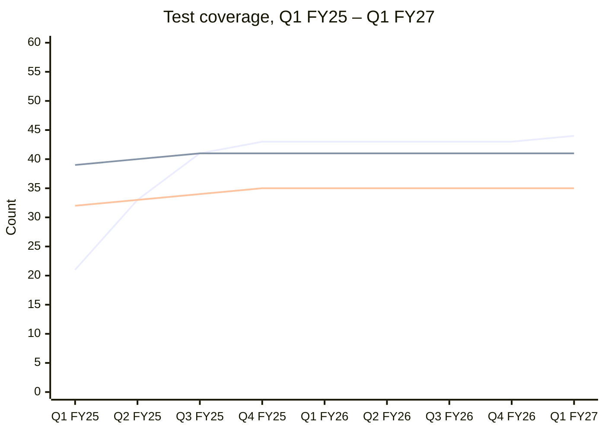

# Measuring Accessibility in the U.S. Web Design System

**Peer benchmark, metrics and baselines, and quarterly scorecard**

| | |
|---|---|
| **Prepared by** | Gray Brooks, TTS |
| **Draft date** | October 26, 2026 |
| **Status** | Draft for approval. After approval, the scorecard (Section 6) is posted to uswds/uswds as a GitHub Discussion within 2 business days. |
| **Standard** | WCAG 2.2 Level A and AA (55 success criteria) |
| **Baseline date** | October 1, 2026 (first day of FY2027) |
| **History** | Quarterly, from October 1, 2024 |
| **Target date** | September 30, 2027 (end of FY2027) |

---

## Contents

1. [Summary](#1-summary)
2. [Scope, standard, and data sources](#2-scope-standard-and-data-sources)
3. [Peer benchmark](#3-peer-benchmark)
4. [Metrics, baselines, and FY2027 targets](#4-metrics-baselines-and-fy2027-targets)
5. [Practices USWDS should adopt](#5-practices-uswds-should-adopt)
6. [Quarterly scorecard](#6-quarterly-scorecard)
7. [How the scorecard refreshes automatically](#7-how-the-scorecard-refreshes-automatically)
8. [Data left out, and why](#8-data-left-out-and-why)
9. [Next steps](#9-next-steps)
- [Appendix A. Reproducing every number](#appendix-a-reproducing-every-number)
- [Appendix B. Script source](#appendix-b-script-source)
- [Appendix C. Sources](#appendix-c-sources)

---

## 1. Summary

USWDS already collects much of the evidence a measurement program needs. It has 44 component checklists with 503 recorded manual test results, and it runs an axe-core scan in CI on every pull request. What it lacks is a way to roll that evidence up and watch it move. This report sets out that roll-up. It defines **11 metrics**, each with a definition, data source, reproducible baseline, eight quarters of history, and an FY2027 target tied to what **ten peer design systems** do.

**What the baseline shows (as of October 1, 2026)**

- **Coverage grew quickly, then stalled.** Components with a published manual checklist rose from 21 to 43 of 48 between October 2024 and July 2025. Only one more has been added since (44 of 48 now). WCAG 2.2 criteria with a manual test have stayed at 35 of 55 since mid-2025.
- **Automated testing is constant but narrow.** The CI scan has run throughout, but it checks only 19 of the 55 criteria. That is the ceiling of axe-core's default rules, and it hasn't changed in two years.
- **The manual results are going stale.** Only 2.4% of manual test results were recorded on a release within two minor versions of the current one (v3.14.0). Most were run on v3.8.x, which shipped in 2024. In October 2024 the figure was 88%.
- **Fix activity restarted in mid-2026.** Merged pull requests that name an accessibility issue as fixed went from zero (October 2024 through May 2026) to 11 between June and September 2026. Several of those issues were two to three years old.
- **Ten issues linked from failing or conditional test results have no recorded fix.** This count rose from 5 to 10 as more checklists were published, because more checklists surface more known issues.

**What the benchmark shows**

- Every peer with a public repository runs **axe-core in CI**. Carbon also runs a second engine, IBM's Equal Access Accessibility Checker.
- **No peer publishes accessibility metrics over time.** Three publish point-in-time results:
  - GOV.UK publishes a WCAG 2.2 AA accessibility statement with a known-issues list.
  - GitHub publishes an Accessibility Conformance Report (ACR) for Primer.
  - Carbon publishes a per-component test-status table.
- Most peers publish **process but no results**.

A quarterly USWDS scorecard would therefore go further than any peer reviewed. The FY2027 targets are chosen to reach peer-level coverage and transparency without overpromising.

> **About M9–M11.** These three metrics are meant to come from the uswds/uswds issue tracker. The GitHub issue API was not available to this analysis. For this baseline they are computed as **git-based proxies**, from the issue numbers that merged pull requests and the published test data cite. Section 4 explains each proxy and its bias. The refresh workflow in Section 7 already includes the step that replaces them with direct issue-tracker data once it runs with API access.

---

## 2. Scope, standard, and data sources

### 2.1 Scope

The core metrics measure **USWDS itself**: its components, the uswds/uswds code repository, the issue references that pull requests leave in git, and the accessibility test data published on designsystem.digital.gov. Real-world use on agency websites (Site Scanning) is out of scope for the core metrics; see [Section 8](#8-data-left-out-and-why).

### 2.2 WCAG 2.2 versus 2.1

- **Data recorded under WCAG 2.1 AA is used for criteria that didn't change in 2.2**, as agreed. The test data's `wcag_criterion` field is matched against the WCAG 2.2 A/AA list.
- **4.1.1 Parsing is excluded.** It was removed in WCAG 2.2, which leaves 55 A/AA criteria. No USWDS manual test cites 4.1.1. axe-core's `duplicate-id` rules for 4.1.1 are off by default and aren't counted.
- **The six A/AA criteria new in WCAG 2.2** are listed below with their coverage. Criteria without a test count as not covered.

| New in 2.2 | Level | Manual test in USWDS data? | Automated (axe default rules)? |
|---|---|---|---|
| 2.4.11 Focus Not Obscured (Minimum) | AA | Yes | No |
| 2.5.7 Dragging Movements | AA | Yes | No |
| 2.5.8 Target Size (Minimum) | AA | Yes | No. The `target-size` rule exists but is off by default. |
| 3.2.6 Consistent Help | A | No | No |
| 3.3.7 Redundant Entry | A | No | No |
| 3.3.8 Accessible Authentication (Minimum) | AA | No | No |

**Result: 3 of the 6 new criteria are covered**, all by manual tests only.

### 2.3 Data sources

| Source | What it gives | How it's read |
|---|---|---|
| [uswds/uswds-site `_data/accessibility-tests/*.yml`](https://github.com/uswds/uswds-site/tree/main/_data/accessibility-tests) | Manual test results. Each of the 503 items records a WCAG criterion, a result (pass, fail, conditional, or exception), the test type (general, zoom, keyboard, or screen reader), the version tested, and an optional linked issue. | Read at the last commit before each quarter date. The file history has 342 commits. |
| uswds/uswds-site `_components/` | The list of component documentation pages (48), used as the denominator for checklist coverage | Read at the same commits |
| [uswds/uswds](https://github.com/uswds/uswds) `package.json`, `package-lock.json`, `packages/`, `.storybook/` | Whether the CI accessibility scan runs, which axe-core version, and which component packages have stories to scan | Read at the last commit on `develop` before each quarter date |
| uswds/uswds merge commits | Merged pull-request numbers, titles, and branch names, plus the issue numbers each PR says it fixes | `git log --first-parent --merges` |
| uswds/uswds release tags | The latest release at each date (v3.8.2 through v3.14.0) | `git tag` |
| [dequelabs/axe-core](https://github.com/dequelabs/axe-core) `lib/rules/*.json` at each version tag | Which WCAG criteria each axe rule checks, and whether it's on by default | Read at the tag USWDS resolved at that date |

All of these are public, so anyone with `git` and Python can reproduce every number. Appendix A gives the commands, and Appendix B gives the full scripts.

---

## 3. Peer benchmark

Ten design systems were reviewed: the six suggested ones plus Visa, Nordhealth (Nord), NYC, and New South Wales. For each, the review covered what it automates, what it tests manually, and what it makes public. "Public" means conformance statements, testing methods, per-component status, audit results, or metrics.

Where the published process is visible, evidence comes from the system's documentation and, for the six with public code, from its repository on October 26, 2026. **"Unknown" means nothing public was found.** The sources checked are listed for each Unknown.

### 3.1 At a glance

| System | Automates | Tests manually | Publishes process? | Publishes results? | Publishes metrics over time? |
|---|---|---|---|---|---|
| **GOV.UK Design System** | axe-core (jest-axe, @axe-core/puppeteer) on component examples. 39 of 43 components have a dedicated accessibility test file. | Acceptance criteria per component. Browser and assistive-technology matrix: screen readers, magnifiers, speech recognition. Research with disabled users. | Yes | **Yes.** WCAG 2.2 AA statement with known issues, plus third-party audits (July 2024). | No |
| **IBM Carbon** | IBM Equal Access Accessibility Checker and axe-core. Accessibility assertions in 123 test directories. Playwright "AVT" jobs in CI. | Keyboard. Screen readers: JAWS, NVDA, VoiceOver. | Yes | **Yes.** Per-component test status in four categories. | No |
| **GitHub Primer** | axe-core and the Storybook a11y addon. 16 test files use axe assertions. | Keyboard, JAWS and NVDA with Chrome, contrast analyzer, high contrast, zoom (ACR methods) | Yes | **Yes.** ACR for Primer docs (Sept. 8, 2026), plus a per-component "accessibility reviewed" flag. | No |
| **Salesforce Lightning** | sa11y (Salesforce's axe-core wrapper) and @axe-core/playwright | Unknown | Partly. Per-component keyboard and ARIA guidance. | ACRs for Lightning Base Components are listed (Winter '26, Spring '26). Their contents weren't verified. | No |
| **Adobe Spectrum** (React Spectrum / React Aria) | axe-playwright through the Storybook test runner | 8 screen reader and browser pairs: VoiceOver on macOS and iOS, JAWS, NVDA, and TalkBack | Partly. The AT matrix is listed. | No | No |
| **Shopify Polaris** | axe-playwright through the Storybook test runner | Stated, but not described | Minimal. Targets WCAG 2.1 A/AA. | No | No |
| **Visa (VPDS)** | Unknown | Unknown. Procedures are internal. | Minimal. Targets WCAG 2.2 AA. | No | No |
| **Nordhealth (Nord)** | Unknown | Unknown | Minimal. "Working toward" WCAG 2.1 AA. | No | No |
| **NYC Design System** | Unknown | Each component is tested against WCAG 2.2 AA and reviewed with the City's Digital Accessibility Coordinator. Testing with users with disabilities. | Partly | No | No |
| **NSW Design System** | Unknown | Unknown | Unknown | No | No |
| ***USWDS (for comparison)*** | *axe-core through the Storybook test runner on 56 of 74 packages* | *503 recorded results across 44 components: general, zoom, keyboard, and screen reader* | *Yes* | ***Yes.** Per-component, per-criterion results.* | ***Not yet.** This report proposes it.* |

### 3.2 System by system

**GOV.UK Design System** ([accessibility statement](https://design-system.service.gov.uk/accessibility-statement))
- *Automates:* Each component has an accessibility test file that runs axe-core against the component's examples in a headless browser. **39 of 43 components** have one. The test files are `accessibility.puppeteer.test.mjs` in `alphagov/govuk-frontend`.
- *Tests manually:*
  - Contributors must meet published accessibility acceptance criteria and test in a supported matrix of browsers and assistive technology.
  - The team researches components with disabled users.
  - Contributors can use a shared template to record their findings.
- *Publishes:*
  - An accessibility statement claiming full WCAG 2.2 AA compliance for the Design System site, the Frontend docs, and the Frontend codebase.
  - The statement reports **0 known non-compliant items** and **2 tracked assistive-technology concerns** that aren't WCAG failures: the details component with Dragon and older VoiceOver, and file upload with Dragon.
  - Third-party audits by the Digital Accessibility Centre (July 2024).
  - The statement was last reviewed December 18, 2024.
  - No metrics or trends.

**IBM Carbon** ([accessibility status](https://carbondesignsystem.com/components/overview/accessibility-status))
- *Automates:* The IBM Equal Access Accessibility Checker (`accessibility-checker`) and axe-core run in Jest and Playwright test suites. **123 directories** in `carbon-design-system/carbon` contain accessibility assertions. CI has dedicated "AVT" (accessibility verification testing) jobs.
- *Tests manually:* Keyboard navigation and screen readers (JAWS, NVDA, VoiceOver).
- *Publishes:* A per-component status table with four categories: default state, advanced states, keyboard, and screen reader. In the 55 components readable on that page:
  - 52 have "Tested" default states.
  - 34 have "Tested" advanced states.
  - 39 have "Tested" keyboard results.
  - 54 are manually screen-reader tested.

  There's no conformance report on the design-system site, and no trends.

**GitHub Primer** ([ACR for Primer docs](https://accessibility.github.com/conformance/primer-docs))
- *Automates:* axe-core 4.9 and the Storybook a11y addon in `primer/react`. 16 test files assert on axe results.
- *Tests manually:* The ACR lists keyboard-only testing, JAWS and NVDA with Chrome, a color contrast analyzer, and platform high-contrast and zoom.
- *Publishes:*
  - An ACR dated September 8, 2026, against WCAG 2.2 A/AA: **46 Supports, 9 Partially Supports, 0 Does Not Support**, and 20 low-priority issues itemized by criterion.
  - Each component's docs metadata carries an `a11yReviewed` field. **67 of 80 components** are marked reviewed, and all of them carry the same date, January 8, 2025. That shows a dated review flag can go stale too.
  - No trends.

**Salesforce Lightning Design System**
- *Automates:* `salesforce-ux/design-system` uses `@axe-core/playwright` and `@sa11y/preset-rules`. sa11y is Salesforce's open-source axe-core wrapper, with Jest, Vitest, and WebdriverIO integrations and preset rulesets ([sa11y](https://opensource.salesforce.com/sa11y)).
- *Tests manually:* **Unknown.** Sources checked:
  - SLDS Accessibility Overview
  - LWC Base Components Accessibility guide
  - sa11y documentation
  - the `salesforce-ux/design-system` repo

  None describes Salesforce's own manual or assistive-technology testing.
- *Publishes:*
  - Per-component keyboard interaction and ARIA guidance, plus accessibility patterns.
  - Accessibility Conformance Reports for Lightning Base Components (Winter '26, and Spring '26 Phase 2) appear on salesforce.com. The PDFs couldn't be opened for this review (blocked to automated retrieval), so their figures aren't used here.

**Adobe Spectrum** ([React Aria quality](https://react-aria.adobe.com/quality))
- *Automates:* `axe-playwright` runs through the Storybook test runner in `adobe/react-spectrum`.
- *Tests manually:* Eight screen reader and browser combinations:
  - VoiceOver on macOS, with Safari and Chrome
  - JAWS on Windows, with Firefox and Chrome
  - NVDA on Windows, with Firefox and Chrome
  - VoiceOver on iOS
  - TalkBack on Android, with Chrome
- *Publishes:* The test matrix, and a wiki of known automated-tool false positives. There are no per-component results. Adobe publishes product-level ACRs, but none was found for Spectrum. The Spectrum design-data spec defines per-component accessibility *intent* fields, not test results.

**Shopify Polaris** ([accessibility](https://polaris-react.shopify.com/foundations/accessibility))
- *Automates:* `axe-playwright` runs through the Storybook test runner (`polaris-react/.storybook/test-runner.ts`).
- *Tests manually:* Polaris states that it uses automated and manual techniques, but doesn't describe them.
- *Publishes:* A target of WCAG 2.1 A/AA, with no per-component status or results. Note that polaris.shopify.com now redirects to Polaris web components on shopify.dev, and the `Shopify/polaris` repo's last commit was September 9, 2026.

**Visa Product Design System** ([VPDS accessibility](https://design.visa.com/about-VPDS/accessibility))
- *Automates and tests manually:* **Unknown.** The testing procedures sit on an internal Visa SharePoint. Sources checked:
  - VPDS accessibility page
  - Visa Global Accessibility Requirements
  - Visa Developer accessibility page
- *Publishes:* A target of WCAG 2.2 AA for all web and mobile components. No results.

**Nordhealth (Nord)** ([accessibility statement](https://nordhealth.design/resources/accessibility-statement))
- *Automates and tests manually:* **Unknown.** Sources checked:
  - accessibility statement
  - accessibility page
  - accessibility checklist
  - the designer's case-study page

  The `nordhealth/design-system` repository isn't public.
- *Publishes:* An undated statement that Nord is working toward WCAG 2.1 AA, plus a checklist for product teams. No audits or results.

**NYC Design System** ([accessibility standards](https://designsystem.nyc.gov/standards/accessibility.html))
- *Automates:* **Unknown.** The page states testing requirements but not methods.
- *Tests manually:*
  - Each component is tested against WCAG 2.2 AA.
  - Each component is reviewed with the City's Digital Accessibility Coordinator.
  - Products are tested with users with disabilities.

  This is required by Local Law 26 of 2016.
- *Publishes:* The requirements, but no component results or conformance statement.

**New South Wales Design System**
- *Automates, tests manually, publishes:* **Unknown.** Sources checked:
  - NSW Design System site
  - Digital NSW toolkit page
  - the community forum thread on the WCAG 2.2 update, which now redirects to a community-closure page

  The design-system repository wasn't located.

### 3.3 What the benchmark means for USWDS

1. **axe-core in CI is table stakes.** All six peers with public code run it, and USWDS does too. Peers don't publish the ceiling that this sets: automated rules reach only about a third of WCAG 2.2 A/AA. Measuring that ceiling (M3) is new.
2. **The leaders pair automation with a per-component manual record.** That's GOV.UK's acceptance criteria, Carbon's status table, and Primer's review flag. USWDS's per-criterion checklists are already more detailed than any of them.
3. **Conformance reporting is the norm among the most mature systems.** GOV.UK (statement), Primer (ACR), and Salesforce (ACRs) account for all 55 criteria, marking each one supported, partially supported, or not applicable. USWDS doesn't yet publish a roll-up of this kind.
4. **Nobody publishes trends.** No peer reports coverage, fix speed, or open accessibility issues over time. For four metrics (M7, M9, M10, M11), the targets therefore rest on USWDS's own history, and the target notes say so.

---

## 4. Metrics, baselines, and FY2027 targets

Eleven metrics, grouped into four questions. M1–M8 come from published test data and the code repository. **M9–M11 cover the issue tracker** and are git-based proxies for this baseline; see the box in Section 1.

| Question | Metrics |
|---|---|
| How much of USWDS do we test? | M1 component checklist coverage · M8 automated scan reach |
| How much of WCAG 2.2 do we test? | M2 manual criteria coverage · M3 automated criteria coverage · M4 combined criteria coverage |
| How accessible is what we tested? | M5 manual pass rate · M6 components with a failing test · M7 test freshness |
| How fast do we fix problems? | M9 accessibility issues fixed · M10 age of issues at fix · M11 known issues with no recorded fix |

The quarterly history for every metric is in the scorecard (Section 6). "Baseline" is October 1, 2026. "Current" is the data as pulled on October 26, 2026. Values are identical for every metric because no tracked file changed in October.

---

### M1. Components with a published manual test checklist

- **Definition:** The number of component documentation pages on designsystem.digital.gov that have a manual accessibility test checklist, divided by the number of component pages.
- **Data source:**
  - The `.yml` files in uswds-site `_data/accessibility-tests/` (numerator)
  - The folders in uswds-site `_components/` (denominator)
  - Both read at the last commit before the date
  - `side-navigation.yml` matches the `sidenav` page
- **Baseline (Oct. 1, 2026):** **44 of 48 (92%).** The four pages without a checklist are data visualizations, figure, form, and validation.
- **History:** 21 → 33 → 41 → 43 (Q4 FY25) → 43 → 43 → 43 → 43 → 44.
- **FY27 target: 48 of 48 (100%).**
- **Why:**
  - GOV.UK has an accessibility test file for 39 of 43 components (91%).
  - Carbon publishes a status for every component it lists.
  - Primer marks 67 of 80 components (84%) as reviewed.

  USWDS is already level with the best of these. Closing the last four gaps makes it the only system with a published per-criterion record for every component. History shows the team added 22 checklists in three quarters, so four in four quarters is realistic.

### M2. WCAG 2.2 A/AA criteria with a manual test

- **Definition:** The number of the 55 WCAG 2.2 A/AA success criteria cited by at least one manual test item. A criterion counts whatever the item's result was. AAA criteria in the data are excluded (Section 8).
- **Data source:** The `wcag_criterion` field across all test items, at each date.
- **Baseline:** **35 of 55 (64%).** The 20 not covered:
  - Time-based media: 1.2.1–1.2.5
  - 1.4.2, 1.4.5
  - 2.1.4, 2.2.1, 2.2.2, 2.3.1, 2.4.2
  - 2.5.1, 2.5.2, 2.5.4
  - 3.1.1, 3.2.6, 3.3.4, 3.3.7, 3.3.8
- **History:** 32 → 33 → 34 → 35, flat since Q4 FY25.
- **FY27 target: 42 of 55 (76%).** That means adding manual tests for 7 component-relevant criteria:
  - The three new 2.2 criteria: 3.2.6, 3.3.7, 3.3.8
  - 2.1.4 Character Key Shortcuts
  - 2.5.1 Pointer Gestures and 2.5.2 Pointer Cancellation, for the range slider, date picker, and modal
  - 3.3.4 Error Prevention, for the form patterns
- **Why:**
  - Primer's ACR and Salesforce's ACRs account for **all 55** criteria.
  - GOV.UK claims full WCAG 2.2 AA conformance.

  The remaining 13 uncovered criteria are mostly media or page-level properties (for example 1.2.x, 2.4.2 Page Titled, 3.1.1 Language of Page). Peers handle those as "Not Applicable" in a conformance report rather than with component tests. Practice P2 in Section 5 covers that.

### M3. WCAG 2.2 A/AA criteria checked by the automated CI scan

- **Definition:** The number of the 55 criteria checked by at least one axe-core rule that is on by default, in the axe-core version uswds/uswds resolves at the date. `test:a11y` runs every Storybook story through axe with no rule customization. AAA tags and 4.1.1 are excluded.
- **Data source:**
  - uswds/uswds `package-lock.json`, which gives the axe-core version (4.10.0 → 4.10.2 → 4.11.4)
  - dequelabs/axe-core `lib/rules/*.json` at that version tag, for rule tags and `enabled` flags
- **Baseline:** **19 of 55 (35%).** The criteria checked are 1.1.1, 1.2.2, 1.3.1, 1.3.5, 1.4.1, 1.4.2, 1.4.3, 1.4.4, 1.4.12, 2.1.1, 2.2.1, 2.2.2, 2.4.1, 2.4.2, 2.4.4, 3.1.1, 3.1.2, 3.3.2, and 4.1.2.
- **History:** 19 in every quarter. Upgrading axe-core and Storybook in June–September 2026 widened *what* gets scanned (open modals and the whole page body; uswds #6787), but not *which criteria* are checked.
- **FY27 target: 20 of 55 (36%).** Turn on axe's `target-size` rule (2.5.8).
- **Why:**
  - Every peer with public code relies on axe-core, which caps automated coverage near this level.
  - Carbon is the only peer that adds a second engine, IBM's Equal Access Checker.

  The target is the one gain that is certain, and practically free. Section 5, P3, estimates what a second engine could add once piloted. Because peers publish no automated-coverage figures, the size of the target also rests on USWDS's flat two-year history.

### M4. WCAG 2.2 A/AA criteria with any test

- **Definition:** The number of the 55 criteria covered by M2 *or* M3.
- **Data source:** The union of the M2 and M3 criterion lists.
- **Baseline:** **41 of 55 (75%).** Six criteria are covered only by automation: 1.2.2, 1.4.2, 2.2.1, 2.2.2, 2.4.2, and 3.1.1.
- **History:** 39 → 40 → 41, flat since Q3 FY25.
- **FY27 target: 48 of 55 (87%).** These are the seven criteria added for M2, none of which axe covers. The other 7 are recorded as not applicable to components, with reasons (P2).
- **Why:** Mature peers (GOV.UK, Primer, Salesforce) account for 100% of criteria in a published conformance document. Testing 48 and documenting 7 as not applicable puts USWDS at the same standard.

### M5. Manual test items that pass

- **Definition:** The share of manual test items whose `test_status` is `pass`. The other results are `conditional`, `exception`, and `fail` (Section 8).
- **Data source:** `test_status` across all items, at each date.
- **Baseline:** **75.3%** (379 of 503). The rest are 110 conditional, 13 exception, and 1 fail.
- **History:** 78.2% → 75.2% → 74.2% → 74.9% (flat) → 75.3%. The 2025 dip came from adding checklists for complex components, which have more conditional results. It doesn't reflect a regression.
- **FY27 target: 80%.**
- **Why:**
  - Primer's ACR rates 46 of 55 criteria (84%) Supports and the rest Partially Supports.
  - GOV.UK reports no non-compliant items.

  Those are criterion-level results, while M5 counts items, so the comparison is approximate. Reaching 80% means moving about 24 items from conditional or fail to pass. Most conditional items cover implementer-dependent behavior. Examples are clear headings (2.4.6, 13 items) and consistent identification (3.2.4, 9 items). Many can be resolved by stating the condition in guidance and retesting the default implementation.

### M6. Components with a failing manual test

- **Definition:** The number of components with at least one test item whose `test_status` is `fail`.
- **Data source:** `test_status` per checklist, at each date.
- **Baseline:** **1.** Input mask fails 3.3.3 Error Suggestion: invalid entries aren't announced, and no correction is suggested (issue #5481).
- **History:** 1 → 0 → 1 → 1 → 1 → 1 → 1 → 1 → 1.
- **FY27 target: 0.**
- **Why:** GOV.UK lists 0 non-compliant items, and Primer's ACR lists 0 criteria that it does not support. A design system's recorded failures should be zero, or explicitly accepted with a published workaround.

### M7. Manual test items run on a current release

- **Definition:** The share of manual test items whose `version_tested` is within two minor versions of the latest USWDS release published before the date. At v3.14.0 that means v3.12.0 or later.
- **Data source:**
  - `version_tested` per item
  - uswds/uswds release tags and their dates
- **Baseline:** **2.4%** (12 of 503). The versions tested break down as:
  - v3.8.x: 361 items
  - v3.7.1: 64
  - v3.11.0: 33
  - v3.5.0: 25
  - v3.13.0: 12
  - other or blank: 8
- **History:** 88.2% (when v3.8.2 was current) → 0.5% → 2.1% → 6.7% → 6.7% → 6.7% → 6.7% → 6.7% → 2.4%. The value collapses whenever releases ship without a retest.
- **FY27 target: 50%.**
- **Why:**
  - Primer's ACR was produced within six weeks of this baseline.
  - GOV.UK's audits are two years old, but its statement records its review date.
  - Primer's per-component review flags all date from January 2025, which shows that without a refresh rule a review flag goes stale the same way.

  No peer publishes a freshness figure, so the 50% level comes from USWDS's own data. Retesting the 15 most interactive components (228 of 503 items) under v3.14 or later, plus table and card (25 items), gets there: 253 of 503 (P4).

### M8. Component packages reached by the CI accessibility scan

- **Definition:** The number of `packages/usa-*` component packages with at least one Storybook story. Those stories are what `npm run test:a11y` scans with axe in CI. Stories that explicitly opt out are noted; at baseline only the intentional failure demo in character count does.
- **Data source:** uswds/uswds `packages/` at each date.
- **Baseline:** **56 of 74 (76%).** The 18 packages without stories are:
  - Form building blocks: error-message, fieldset, form-group, hint, input-list, label, legend, textarea
  - Layout and typography utilities: content, dark-background, display, intro, layout-docs, layout-grid, paragraph, type-line-length, type-setting, type-spacing
- **History:** 56 of 74 in every quarter.
- **FY27 target: 64 of 74 (86%).** Add stories for the 8 form building blocks, and record the 10 utilities as out of scope.
- **Why:** GOV.UK runs an automated accessibility test file for 39 of 43 components (91%). Matching that rate on the packages that render interactive or semantic markup is the comparable bar.

### M9. Accessibility issues fixed, trailing 12 months (issue-tracker proxy)

- **Definition:** The number of distinct uswds/uswds issues named as fixed by an accessibility-related pull request merged to `develop` in the 12 months before the date.
  - A PR is accessibility-related if its title or branch name matches a keyword list: accessib, a11y, screen reader, ARIA, WCAG, contrast, focus, keyboard, VoiceOver, NVDA, JAWS, axe, announce, zoom, reflow.
  - An issue is named as fixed by "Fixes / Closes / Resolves #N" in the PR's commits, or by an issue number in its branch name.
- **Data source:** Merge commits in uswds/uswds (`git log --first-parent --merges`).
- **Baseline:** **11.** The issues are:
  - Fixed in Q4 FY26: #6427 (modal read twice), #6444 (range slider border), #6541 (character count on iOS), #6546 (date picker `aria-current`)
  - Fixed in Q1 FY27: #5316, #5505, #5852, #6567, #6749, #6785, #6840
- **History:** 0 in every quarter through Q3 FY26, then 4, then 11. Six accessibility PRs merged in October–December 2024, but none cited an issue number, so they don't count here.
- **FY27 target: 20.**
- **Why:** No peer publishes fix counts, so this target rests on USWDS's own history. The last two quarters fixed 11 issues, roughly 22 a year. A target of 20 sustains that pace for a full year rather than one burst.
- **Proxy bias:** This undercounts. Fixes whose PR doesn't cite the issue in git (it may cite it only in the PR description) are missed. Once issue API access is available, replace this with "accessibility-labeled issues closed as completed" (`a11y_issue_history.py`, already written).

### M10. Median age of accessibility issues when fixed, trailing 12 months (issue-tracker proxy)

- **Definition:** The median days between an issue's creation and the merge of the PR that fixed it, for the issues counted in M9.
- **How the creation date is estimated:** GitHub numbers issues and pull requests from one counter. So issue #N existed before any PR numbered above N was merged. The creation date is set to the earliest such merge, which is an upper bound, so **M10 is a lower bound**: true ages are at least this long.
- **Data source:** As for M9.
- **Baseline:** **141 days.** The range is 3 days (#6840) to 1,185 days (#5316). For issues *opened in 2026* the median is about 69 days. Clearing old backlog (#5316, #5505, #5852) pushes the overall median up.
- **History:** Not defined (no fixes recorded) until Q4 FY26, then 261.5, then 141.
- **FY27 target: 90 days or fewer.**
- **Why:** No peer publishes time-to-fix, so this rests on USWDS's own data. The team already fixes newly reported issues in about 69 days. Ninety days holds that pace while the remaining old issues are worked off.
- **Proxy bias:** Understated, as explained above. Once the issue API is available, replace this with the median of `closedAt − createdAt`.

### M11. Known accessibility issues with no recorded fix (issue-tracker proxy)

- **Definition:** The number of distinct uswds/uswds issues linked (`github_issue_number`) from a manual test item whose result is fail, conditional, or exception, and that no merged PR names as fixed before the date.
- **Data source:**
  - uswds-site test data, for the issue links at each date
  - uswds/uswds merge commits, for the fixes
- **Baseline:** **10.** They are #5481, #5616, #5828, #5834, #5873, #5971, #6075, #6157, #6241, and #6428.
- **History:** 5 → 6 → 9 → 10, then flat. The rise reflects more checklists *finding and linking* known issues, not new defects.
- **FY27 target: 5 or fewer.**
- **Why:**
  - GOV.UK publishes 2 tracked assistive-technology concerns and 0 non-compliant items.
  - Primer's ACR lists 20 low-priority issues but no high- or medium-priority ones.

  Halving the list in a year matches USWDS's recent pace of about 11 fixes a year, and moves it toward peer levels.
- **Proxy bias:** An issue fixed without a git reference still counts as unfixed, so the first refresh with API access may show a lower number.

> **Site Scanning (optional metric) is not included.** Section 8 explains why.

---

## 5. Practices USWDS should adopt

These four practices come from peer systems. Each estimate says which metric it moves and by how much. Where the effect can't be counted ahead of time, the estimate says so.

**P1. One automated accessibility test file per component (GOV.UK).**
GOV.UK keeps an `accessibility.puppeteer.test.mjs` beside every component and runs axe against every example. USWDS relies on Storybook stories existing, so packages without stories silently go unscanned.
- *Do:* Add stories for the eight form building-block packages. Add a CI check that fails if a `usa-*` package has no story and isn't on an explicit exclusion list. (USWDS added a similar "spec-count floor" for unit tests in September 2026.)
- *Effect:* **M8 56 → 64 of 74 (+11 points).** This also guards against coverage quietly falling as packages are added. Effort: about 1–2 sprint weeks.

**P2. Publish a WCAG 2.2 conformance report, plus an accessibility statement with known issues (Primer, Salesforce, GOV.UK).**
These peers account for every one of the 55 criteria, marking each one supports, partially supports, does not support, or not applicable. GOV.UK pairs its statement with a known-issues list.
- *Do:* Produce a VPAT 2.5 (WCAG edition) ACR for USWDS from the existing checklists. Mark the 7 media and page-level criteria not applicable, with reasons. Publish the known-issues list (M6 and M11) on designsystem.digital.gov.
- *Effect:*
  - Criteria *accounted for* rise from 41 to **55 of 55 (100%)**.
  - M2 and M4 targets become documentable.
  - USWDS gains an external artifact agencies already ask for in procurement.

  Effort: about 3–4 weeks of one accessibility specialist, mostly mapping existing results.

**P3. Add a second automated engine, and turn on the rules axe leaves off (Carbon).**
Carbon runs IBM's Equal Access Accessibility Checker alongside axe-core.
- *Do:* Turn on axe's `target-size` rule now. Then pilot `accessibility-checker` on the Storybook build for one sprint, and map its rule tags to WCAG criteria the same way M3 does.
- *Effect:*
  - **M3 19 → 20 is certain**, from the target-size rule.
  - The second engine's gain can't be counted until the pilot maps its rules. It's expected to be 1–4 criteria, and those criteria get repeated checking on every pull request.
  - A second engine also catches failures axe misses on criteria already covered.

**P4. Date-stamped review per component, with a retest rule (Primer, improved).**
Primer records a review date per component, but every date is January 2025, which shows that a review flag goes stale without a retest rule.
- *Do:*
  - Show `version_tested` on each component's accessibility page (it's already in the data).
  - Adopt a rule: retest any component whose code changed in a minor release, or whose results are more than two minor versions old.
  - Retest the 15 components with the most interactive behavior first: combo box, date picker, date range picker, modal, header, accordion, search, file input, character count, time picker, input mask, range slider, tooltip, in-page navigation, and language selector.
- *Effect:* **M7 2.4% → about 45%** from those 15 components, which hold 228 of the 503 items. That count includes range slider's 12 items that are already current. Adding table and card (25 more items) brings it to 253 of 503, which reaches the 50% target. Effort: about 6–8 tester-weeks at the current level of checklist detail.

---

## 6. Quarterly scorecard

*This section is the one-page document to post as the GitHub Discussion. `render_scorecard.py` (Appendix B) generates it from the three data files and regenerates it each quarter.*

### USWDS accessibility scorecard — data as of 2026-10-26

Standard: WCAG 2.2 Level A + AA (55 success criteria). Baseline: 2026-10-01. FY27 targets are due 2027-09-30.

| # | Metric | Baseline (2026-10-01) | Current | FY27 target | Status vs. baseline |
|---|---|---|---|---|---|
| M1 | Components with a published manual test checklist | 44/48 (92%) | 44/48 (92%) | 48/48 (100%) | ➖ No change |
| M2 | WCAG 2.2 A/AA criteria with a manual test | 35/55 (64%) | 35/55 (64%) | 42/55 (76%) | ➖ No change |
| M3 | WCAG 2.2 A/AA criteria checked by automated CI scan | 19/55 (35%) | 19/55 (35%) | 20/55 (36%) | ➖ No change |
| M4 | WCAG 2.2 A/AA criteria with any test (M2 or M3) | 41/55 (75%) | 41/55 (75%) | 48/55 (87%) | ➖ No change |
| M5 | Manual test items that pass | 75.3% | 75.3% | 80% | ➖ No change |
| M6 | Components with a failing manual test | 1 | 1 | 0 | ➖ No change |
| M7 | Manual test items run on a current release (within 2 minor versions) | 2.4% | 2.4% | 50% | ➖ No change |
| M8 | Component packages reached by the CI accessibility scan | 56/74 (76%) | 56/74 (76%) | 64/74 (86%) | ➖ No change |
| M9 | Accessibility issues fixed, trailing 12 months * | 11 | 11 | 20 | ➖ No change |
| M10 | Median age of accessibility issues at fix, trailing 12 months (days, lower bound) * | 141 | 141 | ≤ 90 | ➖ No change |
| M11 | Failing/conditional test items' tracker issues with no recorded fix * | 10 | 10 | ≤ 5 | ➖ No change |

**Quarterly history** (value on the first day of each quarter)

| # | Q1 FY25<br>2024-10-01 | Q2 FY25<br>2025-01-01 | Q3 FY25<br>2025-04-01 | Q4 FY25<br>2025-07-01 | Q1 FY26<br>2025-10-01 | Q2 FY26<br>2026-01-01 | Q3 FY26<br>2026-04-01 | Q4 FY26<br>2026-07-01 | Q1 FY27<br>2026-10-01 | Trend |
|---|---|---|---|---|---|---|---|---|---|---|
| M1 | 21/48 | 33/48 | 41/48 | 43/48 | 43/48 | 43/48 | 43/48 | 43/48 | 44/48 | ↑ better |
| M2 | 32/55 | 33/55 | 34/55 | 35/55 | 35/55 | 35/55 | 35/55 | 35/55 | 35/55 | ↑ better |
| M3 | 19/55 | 19/55 | 19/55 | 19/55 | 19/55 | 19/55 | 19/55 | 19/55 | 19/55 | → flat |
| M4 | 39/55 | 40/55 | 41/55 | 41/55 | 41/55 | 41/55 | 41/55 | 41/55 | 41/55 | ↑ better |
| M5 | 78.2% | 75.2% | 74.2% | 74.9% | 74.9% | 74.9% | 74.9% | 74.9% | 75.3% | ↓ worse |
| M6 | 1 | 0 | 1 | 1 | 1 | 1 | 1 | 1 | 1 | → flat |
| M7 | 88.2% | 0.5% | 2.1% | 6.7% | 6.7% | 6.7% | 6.7% | 6.7% | 2.4% | ↓ worse |
| M8 | 56/74 | 56/74 | 56/74 | 56/74 | 56/74 | 56/74 | 56/74 | 56/74 | 56/74 | → flat |
| M9 | 0 | 0 | 0 | 0 | 0 | 0 | 0 | 4 | 11 | ↑ better |
| M10 | — | — | — | — | — | — | — | 261.5 | 141 | ↓ better |
| M11 | 5 | 6 | 9 | 10 | 10 | 10 | 10 | 10 | 10 | ↑ worse |

\* M9–M11 are git-based proxies for issue-tracker data (see Methods). M10 shows “—” where no accessibility fix was recorded in the prior 12 months.


Lines, top to bottom at Q1 FY27: M1 components with a checklist (of 48), M4 criteria with any test (of 55), M2 criteria with a manual test (of 55).

**How to read it**

- *Status* compares the current value with the baseline.
- *Trend* compares the first quarter (October 2024) with the latest.
- The chart shows the three coverage metrics. Checklist coverage climbed fast through mid-2025 and then levelled off. Criteria coverage has been flat since spring 2025.

---

## 7. How the scorecard refreshes automatically

The scorecard is built only from public GitHub data, so it can rebuild itself.

- **Workflow:** `refresh-scorecard.yml` (Appendix B) runs on the 2nd of January, April, July, and October, and also on demand. It does four things:
  1. Clones uswds/uswds, uswds/uswds-site, and dequelabs/axe-core. The clones are history-only and fetch file contents on demand, so they're fast.
  2. Runs the three history scripts for every quarter date plus today.
  3. Renders `scorecard.md` and commits it with the data files.
  4. Optionally, updates the body of the scorecard Discussion on uswds/uswds through GitHub's `updateDiscussion` API.
- **Issue-tracker upgrade:** The workflow also exports uswds/uswds issues with `gh issue list` and runs `a11y_issue_history.py`. That gives the direct tracker metrics: open accessibility issues by priority label, completed issues, and median days to close. Once this export has been reviewed, M9–M11 should switch from the git proxies to those numbers. Re-baseline them at that point and footnote the change.
- **Setup needed:**
  - A home for the workflow. The suggestion is this repo, GSA-TTS/uswds-a11y-testing.
  - To edit the Discussion, a token from an account that can edit discussions in uswds/uswds (`SCORECARD_DISCUSSION_TOKEN`), and the Discussion's node ID (`SCORECARD_DISCUSSION_ID`).
  - Without these the workflow still commits the refreshed scorecard. Someone then pastes it into the Discussion.
- **Tested:** The three history scripts and the renderer ran against the live repositories to produce every number in this report. The issue script was tested on a synthetic export. The workflow file validates as YAML, but it hasn't run on GitHub Actions yet, so a first manual run (`workflow_dispatch`) should be checked before relying on the schedule.

---

## 8. Data left out, and why

| Left out | Why | Where it shows up instead |
|---|---|---|
| **"Conditional" results** (110 items) | Conditional means the component passes when implementers use it a certain way, such as writing a clear heading for 2.4.6. That's neither a USWDS pass nor a USWDS failure, so it isn't counted as a pass in M5 or a failure in M6. It does count toward coverage (M2), because the criterion was tested. | M5's denominator. Converting conditionals is the main lever for the M5 target. |
| **"Exception" results** (13 items) | These are documented exceptions to a criterion. Examples: header 2.4.3, search 2.1.1, button 1.4.10, and two each in input mask, language selector, and file input. They're excluded from M5 and M6 for the same reason as conditionals. | M5's denominator, and the known-issues list (P2) |
| **AAA criteria in the test data** (1.3.6, 2.4.8, 2.4.9, 2.4.13, 2.5.5, 3.1.5) | Outside the WCAG 2.2 A/AA standard set for this program | Not counted in M2 or M4. Listed here so the exclusion is visible. |
| **4.1.1 Parsing** | Removed in WCAG 2.2 | Excluded from the 55, and from M3 |
| **The 7 criteria not applicable to components** (1.2.1, 1.2.3, 1.2.4, 1.2.5, 1.4.5, 2.3.1, 2.5.4) | No USWDS component plays media, uses images of text, flashes, or uses motion actuation | Kept in the 55-criterion denominator so nothing is hidden. Proposed to be marked N/A in the conformance report (P2), not tested. |
| **Site Scanning results** | The program allows one Site Scanning metric "if easy to pull." Its accessibility data is gathered per site and mixes USWDS problems with agency content problems. Separating them takes more than a quick pull, and a misattributed metric would mislead. | Proposed as a later, separate "real-world signal" once a USWDS-only attribution method exists |
| **Issue-tracker severity and median time to close** | The GitHub issue API wasn't available for this baseline | M9–M11 proxies. Direct metrics are scripted (Section 7). |
| **Two malformed test-data fields** | Two items use `git_issue_repo` instead of `github_issue_repo`. Three items have a blank `version_tested`. | Both scripts tolerate them: the misspelled key is read, and blank versions count as not current. Worth fixing in uswds-site. |

---

## 9. Next steps

1. **Approve or redirect** the metrics and targets.
2. **Within 2 business days of approval:** post Section 6 as a GitHub Discussion on uswds/uswds, in the Announcements or General category, with a link to the methods.
3. **This quarter:**
   - Run the refresh workflow once by hand.
   - Get issue API access and replace the M9–M11 proxies.
   - Turn on axe `target-size` (P3).
4. **FY27 Q2:**
   - Add the 8 form building-block stories and the CI story check (P1).
   - Start the 15-component retest (P4).
   - Begin the conformance report (P2).
5. **Each quarter after that:** the workflow refreshes the scorecard, and the team reviews any metric marked ⬇️.

---

## Appendix A. Reproducing every number

You need `git`, Python 3.10+ with PyYAML, and an internet connection. The numbers in this report were produced on October 26, 2026. At that point uswds/uswds `develop` was at `029d6d792` (Oct. 9), and uswds-site `main` was at `af13d80f` (Oct. 19).

```bash
git clone --filter=blob:none https://github.com/uswds/uswds.git
git clone --filter=blob:none https://github.com/uswds/uswds-site.git
git clone --filter=blob:none --no-checkout https://github.com/dequelabs/axe-core.git
pip install pyyaml

# M1, M2, M5, M6, M7 (and the issue links used by M11)
python3 a11y_testdata_history.py uswds-site uswds 2026-10-26 > testdata_history.json
# M3, M8 (and the axe criteria list used by M4)
python3 a11y_automation_history.py uswds axe-core 2026-10-26 > automation_history.json
# M9, M10, M11
python3 a11y_fix_history.py uswds uswds-site 2026-10-26 > fix_history.json
# Scorecard (Section 6)
python3 render_scorecard.py testdata_history.json automation_history.json fix_history.json > scorecard.md

# When issue API access is available (replaces the M9–M11 proxies):
gh issue list -R uswds/uswds --state all --limit 10000 \
  --json number,title,state,labels,createdAt,closedAt,stateReason > uswds-issues.json
python3 a11y_issue_history.py uswds-issues.json > issue_history.json
```

**Quarter commits used** (the last commit before each date):

| As-of date | uswds-site commit | uswds commit | Latest release | axe-core |
|---|---|---|---|---|
| 2024-10-01 | `1781d2320` | `e6a8bb267` | v3.8.2 | 4.10.0 |
| 2025-01-01 | `1ff044843` | `2039f5cc8` | v3.11.0 | 4.10.2 |
| 2025-04-01 | `783d033a2` | `1e042e940` | v3.12.0 | 4.10.2 |
| 2025-07-01 | `b44bbbe00` | `ad9ffc19f` | v3.13.0 | 4.10.2 |
| 2025-10-01 | `7d5660244` | `9999d08fe` | v3.13.0 | 4.10.2 |
| 2026-01-01 | `77bb2b09b` | `9999d08fe` | v3.13.0 | 4.10.2 |
| 2026-04-01 | `cb94fa309` | `099294ea4` | v3.13.0 | 4.10.2 |
| 2026-07-01 | `3d5efda42` | `bd45137a7` | v3.13.0 | 4.11.4 |
| 2026-10-01 | `4393275e2` | `c04c67558` | v3.14.0 | 4.11.4 |
| 2026-10-26 | `af13d80f0` | `029d6d792` | v3.14.0 | 4.11.4 |

**Hand checks** that anyone can run without the scripts:

```bash
# M1 numerator at baseline
git -C uswds-site ls-tree --name-only $(git -C uswds-site rev-list -1 --first-parent --before="2026-10-01 00:00" origin/HEAD) _data/accessibility-tests/ | grep -c yml        # 44
# M5 at baseline: count results
git -C uswds-site grep -h "test_status:" 4393275e2 -- _data/accessibility-tests | sort | uniq -c
# M3: axe-core version in use at baseline
git -C uswds show c04c67558:package-lock.json | grep -A1 '"node_modules/axe-core"'        # 4.11.4
```

---

## Appendix B. Script source

Six files: five Python scripts and one GitHub Actions workflow.

### `a11y_testdata_history.py`

Produces M1, M2, M5, M6, M7.

~~~~python
#!/usr/bin/env python3
"""Quarterly history of USWDS manual accessibility test data.

Reads _data/accessibility-tests/*.yml from a local clone of uswds/uswds-site
at the last first-parent commit before each quarter date, plus release tags
from a local clone of uswds/uswds, and prints one JSON row per quarter.

Usage:
  git clone --filter=blob:none https://github.com/uswds/uswds-site.git
  git clone --filter=blob:none https://github.com/uswds/uswds.git
  python3 a11y_testdata_history.py uswds-site uswds > testdata_history.json
"""
import json, re, subprocess, sys
import yaml

SITE, CORE = sys.argv[1], sys.argv[2]
QUARTERS = ["2024-10-01", "2025-01-01", "2025-04-01", "2025-07-01", "2025-10-01",
            "2026-01-01", "2026-04-01", "2026-07-01", "2026-10-01"]
QUARTERS += sys.argv[3:]  # optional extra as-of dates, e.g. today

# WCAG 2.2 Level A + AA success criteria (55; 4.1.1 Parsing removed in 2.2)
WCAG22_A_AA = """1.1.1 1.2.1 1.2.2 1.2.3 1.2.4 1.2.5 1.3.1 1.3.2 1.3.3 1.3.4 1.3.5
1.4.1 1.4.2 1.4.3 1.4.4 1.4.5 1.4.10 1.4.11 1.4.12 1.4.13
2.1.1 2.1.2 2.1.4 2.2.1 2.2.2 2.3.1 2.4.1 2.4.2 2.4.3 2.4.4 2.4.5 2.4.6 2.4.7
2.4.11 2.5.1 2.5.2 2.5.3 2.5.4 2.5.7 2.5.8
3.1.1 3.1.2 3.2.1 3.2.2 3.2.3 3.2.4 3.2.6 3.3.1 3.3.2 3.3.3 3.3.4 3.3.7 3.3.8
4.1.2 4.1.3""".split()
NEW_IN_22 = ["2.4.11", "2.5.7", "2.5.8", "3.2.6", "3.3.7", "3.3.8"]
# Criteria with no component-level relevance in a design system (time-based
# media, page-level properties). Reported separately, never silently dropped.
assert len(WCAG22_A_AA) == 55


def git(repo, *args):
    return subprocess.run(["git", "-C", repo, *args], capture_output=True,
                          text=True, check=True).stdout


def commit_before(repo, date, ref="origin/HEAD"):
    return git(repo, "rev-list", "-1", "--first-parent", f"--before={date} 00:00", ref).strip()


def latest_release(date):
    tags = git(CORE, "tag", "--sort=creatordate",
               "--format=%(creatordate:short) %(refname:short)").split("\n")
    best = None
    for line in tags:
        if not line.strip():
            continue
        d, t = line.split()
        m = re.fullmatch(r"v(\d+)\.(\d+)\.(\d+)", t)
        if m and d < date:
            v = tuple(map(int, m.groups()))
            if best is None or v > best:
                best = v
    return best


def parse_version(s):
    m = re.match(r"v?(\d+)\.(\d+)(?:\.(\d+))?", str(s or ""))
    return tuple(int(x or 0) for x in m.groups()) if m else None


rows = []
for q in QUARTERS:
    c = commit_before(SITE, q)
    files = [f for f in git(SITE, "ls-tree", "--name-only", c,
                            "_data/accessibility-tests/").split()
             if f.endswith(".yml")]
    comp_dirs = [p for p in git(SITE, "ls-tree", "-d", "--name-only", c,
                                "_components/").split() if p]
    rel = latest_release(q)
    items, comps_fail, comps_with_fail_item = [], 0, 0
    issues = set()
    for f in files:
        doc = yaml.safe_load(git(SITE, "show", f"{c}:{f}")) or {}
        if str(doc.get("component_status", "")).strip().lower() == "fail":
            comps_fail += 1
        its = doc.get("test_items") or []
        if any(str(i.get("test_status", "")).strip().lower() == "fail" for i in its):
            comps_with_fail_item += 1
        for i in its:
            items.append(i)
            if i.get("github_issue_number"):
                issues.add((i.get("github_issue_repo") or "uswds",
                            str(i["github_issue_number"])))
    status = {}
    for i in items:
        s = str(i.get("test_status", "")).strip().lower() or "blank"
        status[s] = status.get(s, 0) + 1
    crit = {str(i.get("wcag_criterion", "")).strip() for i in items}
    crit_aa = sorted(crit & set(WCAG22_A_AA), key=lambda s: [int(p) for p in s.split(".")])
    non_aa = sorted(c_ for c_ in crit - set(WCAG22_A_AA) if c_)
    # Freshness: tested on a release within 2 minor versions of the latest
    # release published before the quarter date.
    fresh = 0
    for i in items:
        v = parse_version(i.get("version_tested"))
        if v and rel and v[0] == rel[0] and v[1] >= rel[1] - 2:
            fresh += 1
    n = len(items)
    rows.append({
        "quarter": q,
        "site_commit": c[:9],
        "latest_release": ".".join(map(str, rel)) if rel else None,
        "component_pages": len(comp_dirs),
        "components_with_checklist": len(files),
        "test_items": n,
        "status_counts": status,
        "pass_rate_pct": round(100 * status.get("pass", 0) / n, 1) if n else None,
        "components_status_fail": comps_fail,
        "components_with_failing_item": comps_with_fail_item,
        "wcag22_a_aa_criteria_tested": len(crit_aa),
        "criteria_tested": crit_aa,
        "new_in_22_tested": [x for x in NEW_IN_22 if x in crit_aa],
        "non_a_aa_criteria_in_data": non_aa,
        "fresh_items_pct": round(100 * fresh / n, 1) if n else None,
        "linked_issues": len(issues),
    })

print(json.dumps(rows, indent=1))
~~~~

### `a11y_automation_history.py`

Produces M3, M4, M8.

~~~~python
#!/usr/bin/env python3
"""Quarterly history of USWDS automated accessibility testing.

For each quarter date, reads uswds/uswds at the last first-parent commit before
that date and reports:
  - the axe-core version resolved in package-lock.json
  - which WCAG 2.2 A/AA success criteria that axe-core version checks with rules
    that are on by default (rule tags read from dequelabs/axe-core at that tag)
  - how many usa-* component packages have at least one Storybook story, i.e.
    are reached by `npm run test:a11y` in CI

Usage:
  git clone --filter=blob:none https://github.com/uswds/uswds.git
  git clone --filter=blob:none --no-checkout https://github.com/dequelabs/axe-core.git
  python3 a11y_automation_history.py uswds axe-core [extra-date ...] > automation_history.json
"""
import json, re, subprocess, sys

CORE, AXE = sys.argv[1], sys.argv[2]
QUARTERS = ["2024-10-01", "2025-01-01", "2025-04-01", "2025-07-01", "2025-10-01",
            "2026-01-01", "2026-04-01", "2026-07-01", "2026-10-01"] + sys.argv[3:]
AAA = {"1.2.6", "1.2.7", "1.2.8", "1.2.9", "1.3.6", "1.4.6", "1.4.7", "1.4.8", "1.4.9",
       "2.1.3", "2.2.3", "2.2.4", "2.2.5", "2.2.6", "2.3.2", "2.3.3", "2.4.8", "2.4.9",
       "2.4.10", "2.4.12", "2.4.13", "2.5.5", "2.5.6", "3.1.3", "3.1.4", "3.1.5",
       "3.1.6", "3.2.5", "3.3.5", "3.3.6", "3.3.9"}


def git(repo, *a):
    return subprocess.run(["git", "-C", repo, *a], capture_output=True, text=True,
                          check=True).stdout


_cache = {}


def axe_criteria(version):
    if version in _cache:
        return _cache[version]
    tag = f"v{version}"
    files = [f for f in git(AXE, "ls-tree", "-r", "--name-only", tag, "lib/rules/").split()
             if f.endswith(".json")]
    sc = set()
    for f in files:
        r = json.loads(git(AXE, "show", f"{tag}:{f}"))
        tags = r.get("tags", [])
        if "experimental" in tags or r.get("enabled") is False:
            continue
        if not any(re.fullmatch(r"wcag(2|21|22)(a|aa)", t) for t in tags):
            continue
        for t in tags:
            m = re.fullmatch(r"wcag(\d)(\d)(\d+)", t)
            if m:
                s = ".".join(m.groups())
                if s not in AAA and s != "4.1.1":
                    sc.add(s)
    _cache[version] = sorted(sc, key=lambda s: [int(p) for p in s.split(".")])
    return _cache[version]


rows = []
for q in QUARTERS:
    c = git(CORE, "rev-list", "-1", "--first-parent", f"--before={q} 00:00", "origin/HEAD").strip()
    lock = json.loads(git(CORE, "show", f"{c}:package-lock.json"))
    ver = (lock.get("packages", {}).get("node_modules/axe-core") or {}).get("version")
    pkgs = sorted({p.split("/")[1] for p in git(CORE, "ls-tree", "--name-only", c, "packages/").split()
                   if p.startswith("packages/usa-")})
    with_story = sorted({p.split("/")[1] for p in git(CORE, "ls-tree", "-r", "--name-only", c, "packages").split()
                         if re.match(r"packages/usa-[^/]+/.*stories\.js$", p)})
    in_ci = '"test:a11y"' in git(CORE, "show", f"{c}:package.json")
    crit = axe_criteria(ver) if ver else []
    rows.append({"quarter": q, "core_commit": c[:9], "axe_core": ver, "a11y_scan_in_ci": in_ci,
                 "axe_criteria": len(crit), "axe_criteria_list": crit,
                 "component_packages": len(pkgs), "packages_with_stories": len(with_story),
                 "packages_without_stories": sorted(set(pkgs) - set(with_story))})
print(json.dumps(rows, indent=1))
~~~~

### `a11y_fix_history.py`

Produces M9, M10, M11 (git-based proxies).

~~~~python
#!/usr/bin/env python3
"""Git-based proxy for uswds/uswds issue-tracker metrics.

The GitHub issue API was not available for this baseline, so these numbers come
from what the tracker leaves behind in git: merged pull requests (whose numbers,
branch names and titles are in the merge commits) and the issue numbers those
pull requests say they fix. Re-run against a local clone:

  git clone --filter=blob:none https://github.com/uswds/uswds.git
  python3 a11y_fix_history.py uswds uswds-site > fix_history.json

Definitions
  a11y PR         = merged PR (first-parent merge on develop) whose title or
                    branch name matches the accessibility keyword list below
  fixed issue     = issue number a merged PR names as fixed: "Fixes/Closes/Resolves #N"
                    in its commits, or a 4-digit number in its branch name
  issue created   = estimated as the earliest merge date of any PR numbered
                    above N (GitHub numbers issues and PRs from one counter, so
                    issue N existed before PR N+k was merged). This is an UPPER
                    bound on the creation date, so age-at-fix is a LOWER bound.
"""
import json, re, statistics, subprocess, sys
from datetime import date

CORE, SITE = sys.argv[1], sys.argv[2]
QUARTERS = ["2024-10-01", "2025-01-01", "2025-04-01", "2025-07-01", "2025-10-01",
            "2026-01-01", "2026-04-01", "2026-07-01", "2026-10-01"]
QUARTERS += sys.argv[3:]  # optional extra as-of dates, e.g. today
KW = re.compile(r"a11y|accessib|screen ?reader|\baria\b|aria-|wcag|contrast|focus|"
                r"keyboard|voiceover|\bnvda\b|\bjaws\b|\baxe\b|announce|zoom|reflow",
                re.I)
FIXREF = re.compile(r"\b(?:fix(?:es|ed)?|close[sd]?|resolve[sd]?)\s*:?\s*#(\d{3,5})", re.I)


def git(*a, repo=CORE):
    return subprocess.run(["git", "-C", repo, *a], capture_output=True, text=True,
                          check=True).stdout


merges = []
raw = git("log", "--first-parent", "origin/HEAD", "--merges",
          "--format=%x1e%H|%P|%ad|%s|%b", "--date=short")
for rec in raw.split("\x1e"):
    if "Merge pull request #" not in rec:
        continue
    h, parents, d, subj, body = rec.split("|", 4)
    m = re.search(r"Merge pull request #(\d+)(?: from (\S+))?", subj)
    pr, branch = int(m.group(1)), (m.group(2) or "")
    title = (body.strip() or subj).split("\n")[0]
    ps = parents.split()
    commits = git("log", "--format=%B", f"{ps[0]}..{ps[1]}") if len(ps) > 1 else ""
    refs = {int(x) for x in FIXREF.findall(commits + "\n" + body)}
    refs |= {int(x) for x in re.findall(r"(?<!\d)(\d{4})(?!\d)", branch) if int(x) != pr}
    is_a11y = bool(KW.search(title) or KW.search(branch))
    merges.append({"pr": pr, "date": d, "title": title, "branch": branch,
                   "fixes": sorted(refs), "a11y": is_a11y})

# Upper bound on creation date for any issue/PR number
by_num = sorted((m["pr"], m["date"]) for m in merges)


def created_ub(n):
    later = [d for p, d in by_num if p > n]
    return min(later) if later else None


def ddiff(a, b):
    return (date.fromisoformat(a) - date.fromisoformat(b)).days


fixes = []
for m in merges:
    if not m["a11y"]:
        continue
    for n in m["fixes"]:
        c = created_ub(n)
        fixes.append({"issue": n, "pr": m["pr"], "fixed": m["date"], "created_ub": c,
                      "age_days_lb": ddiff(m["date"], c) if c else None,
                      "title": m["title"]})

# Accessibility issues the published test data links to (uswds repo), and
# whether a merged PR says it fixed them before each quarter date.
linked = {}
for q in QUARTERS:
    c = git("rev-list", "-1", "--first-parent", f"--before={q} 00:00", "origin/HEAD", repo=SITE).strip()
    files = [f for f in git("ls-tree", "--name-only", c, "_data/accessibility-tests/",
                            repo=SITE).split() if f.endswith(".yml")]
    nums = set()
    for f in files:
        txt = git("show", f"{c}:{f}", repo=SITE)
        for blk in re.split(r"\n\s*- summary:", txt):
            mm = re.search(r"github_issue_number:\s*(\d+)", blk)
            st = re.search(r"test_status:\s*(\w+)", blk)
            repo = re.search(r"(?:github|git)_issue_repo:\s*(\S+)", blk)
            if mm and st and st.group(1) in ("fail", "conditional", "exception") \
                    and (not repo or repo.group(1) == "uswds"):
                nums.add(int(mm.group(1)))
    linked[q] = sorted(nums)

all_fix_dates = {}
for m in merges:
    for n in m["fixes"]:
        all_fix_dates.setdefault(n, m["date"])
        all_fix_dates[n] = min(all_fix_dates[n], m["date"])

rows = []
for i, q in enumerate(QUARTERS):
    start = QUARTERS[i - 1] if i else "2024-07-01"
    yr = f"{int(q[:4]) - 1}{q[4:]}"
    a11y_prs_q = [m for m in merges if m["a11y"] and start <= m["date"] < q]
    prs_q = [m for m in merges if start <= m["date"] < q]
    fixed_q = sorted({f["issue"] for f in fixes if start <= f["fixed"] < q})
    ages = [f["age_days_lb"] for f in fixes if yr <= f["fixed"] < q and f["age_days_lb"] is not None]
    open_linked = [n for n in linked[q] if not (n in all_fix_dates and all_fix_dates[n] < q)]
    rows.append({
        "quarter": q,
        "merged_prs_in_quarter": len(prs_q),
        "a11y_prs_in_quarter": len(a11y_prs_q),
        "a11y_issues_fixed_in_quarter": len(fixed_q),
        "a11y_issues_fixed_list": fixed_q,
        "a11y_issues_fixed_trailing_12m": len({f["issue"] for f in fixes if yr <= f["fixed"] < q}),
        "median_age_at_fix_days_lb_12m": statistics.median(ages) if ages else None,
        "test_linked_issues": len(linked[q]),
        "test_linked_issues_still_open": len(open_linked),
        "test_linked_open_list": open_linked,
    })

print(json.dumps({"a11y_fix_events": fixes, "quarters": rows}, indent=1))
~~~~

### `a11y_issue_history.py`

Produces direct issue-tracker metrics, used once the issue API is available.

~~~~python
#!/usr/bin/env python3
"""Quarterly accessibility issue metrics for uswds/uswds.

Input: a JSON export of every issue in the repo, made with
  gh issue list -R uswds/uswds --state all --limit 10000 \
     --json number,title,state,labels,createdAt,closedAt,stateReason > uswds-issues.json

Usage:
  python3 a11y_issue_history.py uswds-issues.json > issue_history.json

Definitions (kept deliberately simple so anyone can re-run them):
  accessibility issue  = has a label whose name matches /accessib|a11y|wcag|508/i
  severity             = the issue's "Priority: ..." label, else "Unprioritized"
  open at date D       = createdAt < D and (closedAt is empty or closedAt >= D)
  time to close        = closedAt - createdAt, in days, for issues closed as
                         "completed" (closed as not planned/duplicate are excluded)
  median time to close at D = median over a11y issues completed in the 12 months before D
"""
import json, re, statistics, sys
from datetime import datetime, timezone

QUARTERS = ["2024-10-01", "2025-01-01", "2025-04-01", "2025-07-01", "2025-10-01",
            "2026-01-01", "2026-04-01", "2026-07-01", "2026-10-01"]
A11Y = re.compile(r"accessib|a11y|wcag|\b508\b", re.I)
PRIORITY = re.compile(r"^priority:\s*(.+)$", re.I)


def ts(s):
    if not s or s.startswith("0001-"):
        return None
    return datetime.fromisoformat(s.replace("Z", "+00:00"))


def day(d):
    return datetime.fromisoformat(d).replace(tzinfo=timezone.utc)


issues = json.load(open(sys.argv[1]))
a11y = []
for i in issues:
    names = [l["name"] for l in i.get("labels", [])]
    if any(A11Y.search(n) for n in names):
        pr = next((PRIORITY.match(n).group(1).strip() for n in names if PRIORITY.match(n)),
                  "Unprioritized")
        a11y.append({"number": i["number"], "created": ts(i["createdAt"]),
                     "closed": ts(i.get("closedAt")), "priority": pr,
                     "reason": (i.get("stateReason") or "").upper()})

rows = []
for q in QUARTERS:
    D = day(q)
    open_now = [i for i in a11y if i["created"] < D and (i["closed"] is None or i["closed"] >= D)]
    by_pri = {}
    for i in open_now:
        by_pri[i["priority"]] = by_pri.get(i["priority"], 0) + 1
    year_ago = D.replace(year=D.year - 1)
    done = [i for i in a11y if i["closed"] and year_ago <= i["closed"] < D
            and i["reason"] in ("COMPLETED", "")]
    days = [(i["closed"] - i["created"]).days for i in done]
    q_start = day(QUARTERS[QUARTERS.index(q) - 1]) if QUARTERS.index(q) else None
    opened_q = closed_q = None
    if q_start:
        opened_q = sum(1 for i in a11y if q_start <= i["created"] < D)
        closed_q = sum(1 for i in a11y if i["closed"] and q_start <= i["closed"] < D)
    rows.append({
        "quarter": q,
        "open_a11y_issues": len(open_now),
        "open_by_priority": dict(sorted(by_pri.items())),
        "open_older_than_1y": sum(1 for i in open_now if (D - i["created"]).days > 365),
        "completed_last_12m": len(done),
        "median_days_to_close_12m": statistics.median(days) if days else None,
        "opened_in_quarter": opened_q,
        "closed_in_quarter": closed_q,
    })

print(json.dumps({"a11y_issue_count_all_time": len(a11y), "quarters": rows}, indent=1))
~~~~

### `render_scorecard.py`

Produces the Section 6 scorecard.

~~~~python
#!/usr/bin/env python3
"""Render the one-page USWDS accessibility scorecard (Markdown) from the three
history files. Baseline date is fixed at 2026-10-01; "current" is the last
as-of date in the files (pass today's date to the history scripts).

Usage:
  python3 render_scorecard.py testdata_history.json automation_history.json \
      fix_history.json > scorecard.md
"""
import json, sys

td = {r["quarter"]: r for r in json.load(open(sys.argv[1]))}
au = {r["quarter"]: r for r in json.load(open(sys.argv[2]))}
fx = {r["quarter"]: r for r in json.load(open(sys.argv[3]))["quarters"]}
BASE = "2026-10-01"
HIST = ["2024-10-01", "2025-01-01", "2025-04-01", "2025-07-01", "2025-10-01",
        "2026-01-01", "2026-04-01", "2026-07-01", BASE]
CUR = sorted(set(td) & set(au) & set(fx))[-1]
QLBL = ["Q1 FY25", "Q2 FY25", "Q3 FY25", "Q4 FY25", "Q1 FY26",
        "Q2 FY26", "Q3 FY26", "Q4 FY26", "Q1 FY27"]


def union(q):
    return len(set(td[q]["criteria_tested"]) | set(au[q]["axe_criteria_list"]))


def pct(n, d):
    return f"{n}/{d} ({100 * n / d:.0f}%)"


# (id, name, value-fn returning (number, display), target number, target display, higher_is_better)
METRICS = [
    ("M1", "Components with a published manual test checklist",
     lambda q: (td[q]["components_with_checklist"], pct(td[q]["components_with_checklist"], td[q]["component_pages"])),
     48, "48/48 (100%)", True),
    ("M2", "WCAG 2.2 A/AA criteria with a manual test",
     lambda q: (td[q]["wcag22_a_aa_criteria_tested"], pct(td[q]["wcag22_a_aa_criteria_tested"], 55)),
     42, "42/55 (76%)", True),
    ("M3", "WCAG 2.2 A/AA criteria checked by automated CI scan",
     lambda q: (au[q]["axe_criteria"], pct(au[q]["axe_criteria"], 55)),
     20, "20/55 (36%)", True),
    ("M4", "WCAG 2.2 A/AA criteria with any test (M2 or M3)",
     lambda q: (union(q), pct(union(q), 55)),
     48, "48/55 (87%)", True),
    ("M5", "Manual test items that pass",
     lambda q: (td[q]["pass_rate_pct"], f'{td[q]["pass_rate_pct"]}%'),
     80, "80%", True),
    ("M6", "Components with a failing manual test",
     lambda q: (td[q]["components_with_failing_item"], str(td[q]["components_with_failing_item"])),
     0, "0", False),
    ("M7", "Manual test items run on a current release (within 2 minor versions)",
     lambda q: (td[q]["fresh_items_pct"], f'{td[q]["fresh_items_pct"]}%'),
     50, "50%", True),
    ("M8", "Component packages reached by the CI accessibility scan",
     lambda q: (au[q]["packages_with_stories"], pct(au[q]["packages_with_stories"], au[q]["component_packages"])),
     64, "64/74 (86%)", True),
    ("M9", "Accessibility issues fixed, trailing 12 months *",
     lambda q: (fx[q]["a11y_issues_fixed_trailing_12m"], str(fx[q]["a11y_issues_fixed_trailing_12m"])),
     20, "20", True),
    ("M10", "Median age of accessibility issues at fix, trailing 12 months (days, lower bound) *",
     lambda q: (fx[q]["median_age_at_fix_days_lb_12m"],
                "—" if fx[q]["median_age_at_fix_days_lb_12m"] is None else f'{fx[q]["median_age_at_fix_days_lb_12m"]:g}'),
     90, "≤ 90", False),
    ("M11", "Failing/conditional test items' tracker issues with no recorded fix *",
     lambda q: (fx[q]["test_linked_issues_still_open"], str(fx[q]["test_linked_issues_still_open"])),
     5, "≤ 5", False),
]


def status(v, base, tgt, hib):
    if v is None:
        return "—"
    if (hib and v >= tgt) or (not hib and v <= tgt):
        return "✅ Met"
    if base is None or v == base:
        return "➖ No change"
    better = v > base if hib else v < base
    return "⬆️ Improving" if better else "⬇️ Slipping"


out = []
out.append(f"### USWDS accessibility scorecard — data as of {CUR}\n")
out.append("Standard: WCAG 2.2 Level A + AA (55 success criteria). Baseline: 2026-10-01. "
           "FY27 targets are due 2027-09-30.\n")
out.append("| # | Metric | Baseline (2026-10-01) | Current | FY27 target | Status vs. baseline |")
out.append("|---|---|---|---|---|---|")
for mid, name, fn, tgt, tdisp, hib in METRICS:
    b, bd = fn(BASE)
    c, cd = fn(CUR)
    out.append(f"| {mid} | {name} | {bd} | {cd} | {tdisp} | {status(c, b, tgt, hib)} |")
out.append("")
out.append("**Quarterly history** (value on the first day of each quarter)\n")
out.append("| # | " + " | ".join(f"{l}<br>{d}" for l, d in zip(QLBL, HIST)) + " | Trend |")
out.append("|---" * (len(HIST) + 2) + "|")
for mid, name, fn, tgt, tdisp, hib in METRICS:
    vals = [fn(q) for q in HIST]
    first = next((v for v, _ in vals if v is not None), None)
    last = vals[-1][0]
    if first is None or last is None or first == last:
        tr = "→ flat"
    else:
        tr = ("↑" if last > first else "↓") + (" better" if (last > first) == hib else " worse")
    cells = [d.split(" ")[0] if "/" in d else d for _, d in vals]
    out.append(f"| {mid} | " + " | ".join(cells) + f" | {tr} |")
out.append("")
out.append("\\* M9–M11 are git-based proxies for issue-tracker data (see Methods). "
           "M10 shows “—” where no accessibility fix was recorded in the prior 12 months.\n")
m1 = [td[q]["components_with_checklist"] for q in HIST]
m4 = [union(q) for q in HIST]
m2 = [td[q]["wcag22_a_aa_criteria_tested"] for q in HIST]
out.append("```mermaid")
out.append("xychart-beta")
out.append('    title "Test coverage, Q1 FY25 – Q1 FY27"')
out.append("    x-axis [" + ", ".join(f'"{l}"' for l in QLBL) + "]")
out.append('    y-axis "Count" 0 --> 60')
out.append("    line [" + ", ".join(map(str, m1)) + "]")
out.append("    line [" + ", ".join(map(str, m4)) + "]")
out.append("    line [" + ", ".join(map(str, m2)) + "]")
out.append("```")
out.append("Lines, top to bottom at Q1 FY27: M1 components with a checklist (of 48), "
           "M4 criteria with any test (of 55), M2 criteria with a manual test (of 55).")
print("\n".join(out))
~~~~

### `refresh-scorecard.yml`

Produces the GitHub Actions workflow (Section 7).

~~~~yaml
# .github/workflows/refresh-scorecard.yml
# Rebuilds the USWDS accessibility scorecard from public GitHub data.
# Runs on the 2nd day of each federal-fiscal quarter month and on demand.
# Put the five Python scripts in scripts/ in the repo that hosts this workflow
# (suggested: GSA-TTS/uswds-a11y-testing).
name: Refresh accessibility scorecard

on:
  schedule:
    - cron: "17 13 2 1,4,7,10 *"   # 13:17 UTC on Jan/Apr/Jul/Oct 2
  workflow_dispatch:

permissions:
  contents: write

jobs:
  refresh:
    runs-on: ubuntu-latest
    steps:
      - uses: actions/checkout@v4

      - uses: actions/setup-python@v5
        with:
          python-version: "3.12"

      - name: Install dependencies
        run: pip install pyyaml

      - name: Clone source repositories (history needed, file contents fetched on demand)
        run: |
          git clone --filter=blob:none https://github.com/uswds/uswds.git ../uswds
          git clone --filter=blob:none https://github.com/uswds/uswds-site.git ../uswds-site
          git clone --filter=blob:none --no-checkout https://github.com/dequelabs/axe-core.git ../axe-core

      - name: Compute history (quarter dates plus today)
        run: |
          TODAY=$(date -u +%F)
          mkdir -p data
          python3 scripts/a11y_testdata_history.py ../uswds-site ../uswds "$TODAY" > data/testdata_history.json
          python3 scripts/a11y_automation_history.py ../uswds ../axe-core "$TODAY" > data/automation_history.json
          python3 scripts/a11y_fix_history.py ../uswds ../uswds-site "$TODAY" > data/fix_history.json
          python3 scripts/render_scorecard.py data/testdata_history.json \
            data/automation_history.json data/fix_history.json > scorecard.md

      # Optional: when the issue API is available, replace the M9-M11 proxies with
      # tracker data. GITHUB_TOKEN can read public issues in another repo.
      - name: Export uswds/uswds issues
        env:
          GH_TOKEN: ${{ secrets.GITHUB_TOKEN }}
        run: |
          gh issue list -R uswds/uswds --state all --limit 10000 \
            --json number,title,state,labels,createdAt,closedAt,stateReason > data/uswds-issues.json
          python3 scripts/a11y_issue_history.py data/uswds-issues.json > data/issue_history.json

      - name: Commit refreshed scorecard
        run: |
          git config user.name "github-actions[bot]"
          git config user.email "41898282+github-actions[bot]@users.noreply.github.com"
          git add scorecard.md data/
          git diff --cached --quiet || git commit -m "Refresh accessibility scorecard $(date -u +%F)"
          git push

      # Optional: keep the public GitHub Discussion in sync. Needs a token from an
      # account that can edit discussions in uswds/uswds, stored as
      # SCORECARD_DISCUSSION_TOKEN, and the discussion's node ID as a repo variable.
      - name: Update the scorecard Discussion
        if: ${{ vars.SCORECARD_DISCUSSION_ID != '' }}
        env:
          GH_TOKEN: ${{ secrets.SCORECARD_DISCUSSION_TOKEN }}
        run: |
          gh api graphql \
            -f query='mutation($id:ID!,$body:String!){updateDiscussion(input:{discussionId:$id,body:$body}){discussion{url}}}' \
            -f id="${{ vars.SCORECARD_DISCUSSION_ID }}" \
            -f body="$(cat scorecard.md)"
~~~~


---

## Appendix C. Sources

**USWDS (data)**
- uswds/uswds repository: https://github.com/uswds/uswds
- uswds/uswds issues: https://github.com/uswds/uswds/issues
- uswds-site accessibility test data: https://github.com/uswds/uswds-site/tree/main/_data/accessibility-tests
- axe-core rule definitions: https://github.com/dequelabs/axe-core/tree/develop/lib/rules
- WCAG 2.2: https://www.w3.org/TR/WCAG22/

**Peer systems**
- GOV.UK Design System accessibility statement: https://design-system.service.gov.uk/accessibility-statement
- GOV.UK Frontend repository (accessibility tests, contributor testing docs): https://github.com/alphagov/govuk-frontend
- Carbon accessibility status: https://carbondesignsystem.com/components/overview/accessibility-status
- Carbon repository: https://github.com/carbon-design-system/carbon
- GitHub ACR for Primer docs: https://accessibility.github.com/conformance/primer-docs
- Primer React repository: https://github.com/primer/react
- Salesforce sa11y: https://opensource.salesforce.com/sa11y
- Salesforce LWC base components accessibility: https://developer.salesforce.com/docs/platform/lwc/guide/base-components-accessibility.html
- SLDS accessibility overview: https://spring-21.lightningdesignsystem.com/accessibility/overview
- Lightning Base Components ACRs (listed): https://www.salesforce.com/en-us/wp-content/uploads/sites/4/documents/legal/508%20accessibility/lightning-base-components-winter-26-accessibility-conformance-report.pdf
- SLDS repository: https://github.com/salesforce-ux/design-system
- React Aria quality and testing: https://react-aria.adobe.com/quality
- Adobe accessibility initiatives: https://adobe.com/trust/accessibility/initiatives.html
- Spectrum design-data accessibility spec: https://opensource.adobe.com/spectrum-design-data/spec/accessibility/
- React Spectrum repository: https://github.com/adobe/react-spectrum
- Polaris accessibility: https://polaris-react.shopify.com/foundations/accessibility
- Polaris repository: https://github.com/Shopify/polaris
- Visa VPDS accessibility: https://design.visa.com/about-VPDS/accessibility
- Nord accessibility statement: https://nordhealth.design/resources/accessibility-statement
- Nord accessibility page: https://nordhealth.design/accessibility/
- NYC Design System accessibility standards: https://designsystem.nyc.gov/standards/accessibility.html
- NSW Design System: https://digital.nsw.gov.au/delivery/digital-service-toolkit/design-system
